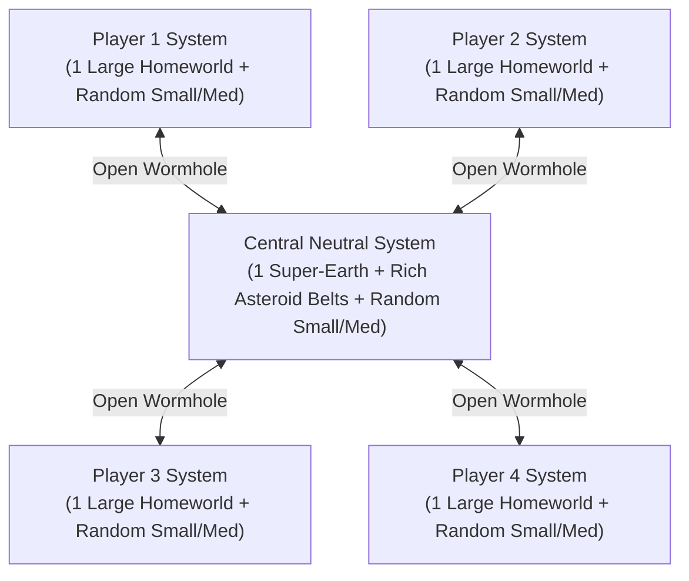
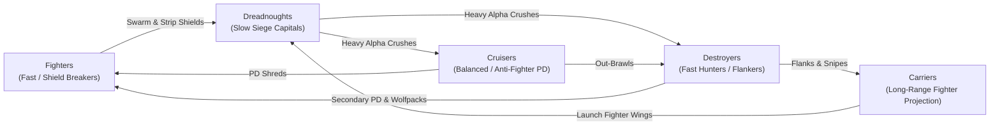
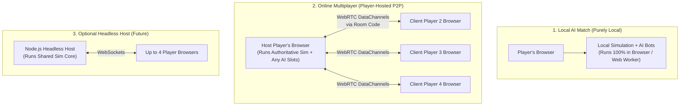

# StarConquest

> **Blueprint & Source of Truth**: This document is the canonical design and technical blueprint for **StarConquest**. Every gameplay system, balance rule, visual standard, and architectural decision is recorded here and must be kept up to date as the project evolves.

**StarConquest** is a browser-based, 4-player real-time strategy (RTS) game set in deep space. Presented in a **2.5D/3D space view with an orbital camera**, it combines **macro-focused tug-of-war fleet command** with **orbital base management**, **spatial tower defence**, and a **5-class Rock-Paper-Scissors (RPS) combat loop**.

Rather than relying on high-APM individual unit micro, players focus on grand strategy: securing asymmetric resource lines, customizing planetary orbital rings, fortifying wormhole choke points, configuring production queues, and setting fleet rally points and patrol routes.

---

## 1. Core Gameplay Pillars

1. **Macro-Focused Tug-of-War RTS**: Players command fleets via rally points, patrol routes, and automated engagement stances rather than twitch micro-management.
2. **Orbital Ring Base Building**: Planets have a fixed number of orbital slots based on their size. Every slot matters—forcing meaningful trade-offs between economy, ship production, tech specialization, and planetary defense.
3. **Asymmetric Economy & Forced Conflict**: Starting systems have skewed resource distributions (Ore-heavy or Crystal-heavy), compelling players to expand into a contested central system.
4. **Tactical Choke-Point Fortification**: Wormholes are open spatial corridors. Players project power around them using fragile Logistics Hubs that enable forward Defence Towers and Fighter operations.
5. **Tactical Rock-Paper-Scissors Combat**: Five distinct combat ship classes interact through a directional counter-matrix driven by weapon tracking, shields vs. hull mechanics, and fleet screening.

---

## 2. Galaxy Topology & Star Systems

A match supports up to **4 players** across **5 star systems** arranged in a hub-and-spoke layout:

### System Rules
* **Starter Systems (x4)**:
  * Each player begins in a unique outer system containing a guaranteed **Large Homeworld** (10 orbital slots) and a randomized number of secondary **Small** (6 slots) or **Medium** (8 slots) planets.
  * Contains enough initial Ore and Crystal asteroid belts to bootstrap a base and early fleet, but with an **asymmetric resource mix** (e.g., rich in Ore but scarce in Crystals, or vice versa).
* **Central Neutral System (x1)**:
  * A resource-rich contested hub anchored by a single **Super-Earth** (12 orbital slots) alongside randomized Small/Medium planets and dense asteroid belts.
  * Always generates **4 wormholes**—one leading to each of the 4 player starter systems, even in matches with fewer than 4 human/AI players (allowing flanking or expansion into empty starter systems).
* **Wormholes**:
  * Wormholes are **open spatial choke points**—fleets and Harvesters fly directly through them without loading screens or activation locks.
  * Because any unit can transit freely, wormhole mouths are the primary flashpoints for **Logistics Hubs** and **Defence Towers**.

---

## 3. Economy & Resource Harvesting

### Resources
Resources are mined from asteroid belts scattered randomly throughout each star system:
* **Ore**: The foundational industrial resource. Primarily used for basic ship hulls (Fighters, Destroyers, Harvesters), basic orbital structures, and defensive towers.
* **Crystals**: The high-tech resource. Required for advanced capital ships (Cruisers, Carriers, Dreadnoughts), shield systems, heavy weaponry, and specialization modules.

### Refineries & Harvesters
* **Automated Harvesting**: Constructing a **Refinery** (or using the starting Command & Control's built-in drop-off) automatically provides **1 free Harvester**, with the option to queue additional Harvesters at the Refinery.
* **Mining Loop**: Harvesters automatically fly to the nearest safe asteroid belt, extract Ore or Crystals, and return them to the nearest friendly Refinery or Command & Control.
* **The Central Super-Earth Advantage**:
  * Mining in the Central Neutral System without a local base forces Harvesters to transit back through wormholes to their home system—making them slow and vulnerable to enemy raids.
  * Capturing the central **Super-Earth** (or a neutral secondary planet) and constructing a local **Refinery** allows Harvesters to process resources locally in the central hub, massively accelerating income.

---

## 4. Planetary Orbital Rings & Structures

Structures are built in a visible **orbital ring** around planets. Each planet class supports a maximum number of orbital slots:

| Planet Class | Orbital Slots | Typical Location |
| :--- | :---: | :--- |
| **Small Planet** | **6 Slots** | Randomized secondary planets in starter & central systems |
| **Medium Planet** | **8 Slots** | Randomized secondary planets in starter & central systems |
| **Large Planet** | **10 Slots** | Guaranteed starting Homeworld for each player |
| **Super-Earth** | **12 Slots** | Unique centerpiece of the Central Neutral System |

### Orbital Structure Types

| Structure | Slot Cost | Role & Mechanics |
| :--- | :---: | :--- |
| **Command & Control (C&C)** | **2 Slots** | **Unique Homeworld headquarters.** Massive HP pool, built-in basic resource drop-off, base Fleet Supply, and limited Point Defence turrets. **If a player's C&C is destroyed, they are defeated.** |
| **Planetary Outpost / Hub** | **1 Slot** | Required first structure to claim an unowned secondary planet (Small, Medium, or Super-Earth) and unlock its remaining orbital slots. |
| **Orbital Dockyard (Shipyard)** | **2 Slots** | Constructs combat ships via manual queues or **toggleable auto-repeat**. Players set rally points or patrol routes directly from Dockyards. Initial Dockyards only build basic craft until expanded via Tech Modules. |
| **Refinery** | **1 Slot** | Local drop-off and processing center for Ore and Crystals. Spawns 1 free Harvester on completion and can queue additional Harvesters. |
| **Tech / Specialization Module** | **1 Slot** | Orbital expansion modules that unlock advanced ship hulls (Cruisers, Carriers, Dreadnoughts), increase **Fleet Supply**, or grant doctrine bonuses (e.g., enhanced fighter bays, heavy siege calibration, shield boosters). |
| **Heavy Defense Platform / Shield** | **2 Slots** | Fortifies the planet's orbital ring with heavy batteries and planetary shielding to protect orbital infrastructure against enemy fleets. |

---

## 5. Deep-Space Logistics & Tower Defence

Outside of planetary rings, players cannot build structures freely in open space. Instead, they must project an operational tether using **Logistics Hubs**.

### Logistics Hubs
* **Role**: Forward deep-space support stations placed near wormholes, asteroid belts, or staging zones.
* **Attributes**: Moderate resource cost, low hull/shield durability, and a generous **Build & Operational Radius**.
* **Functions**:
  1. **Tower Construction Radius**: Enables the placement of Defence Towers within its radius.
  2. **Fighter Operations**: Acts as a forward carrier base, allowing short-range **Fighters** to operate and refuel in the area.
  3. **Fleet Logistics**: Increases the player's **Fleet Supply cap** and provides slow out-of-combat hull repair to nearby friendly ships.
* **Tactical Counterplay**: Because Logistics Hubs have low durability compared to planetary bases, an attacker can either batter through the defensive towers with siege ships or snipe the Logistics Hub to disable/strand the surrounding defences and fighters.

### Defence Towers
Must be constructed within the radius of a friendly Logistics Hub:
* **Point Defence (PD) Tower**:
  * **High tracking, rapid fire, low alpha damage.**
  * Excels at shredding **Fighters** and fast **Destroyers**, and steadily chipping away at light shields.
* **Hull Breaker Tower**:
  * **Very low tracking, slow reload, massive alpha strike.**
  * Designed to punish slow-moving capital ships (**Dreadnoughts**, **Carriers**, **Cruisers**), dealing devastating structural damage once their shields are stripped.

---

## 6. Combat Mechanics & Ship Classes

### Shields vs. Hull System
* **Shields** are present only on **Cruisers, Carriers, Dreadnoughts, and Orbital Structures**. Shields absorb incoming damage and regenerate over time when out of combat.
* **Hull** is the permanent structural health of every unit and building. **Fighters and Destroyers are Hull-only**, relying on speed, small profiles, and evasion rather than shields.
* **Shield Breaking vs. Hull Breaking**:
  * **Fighters** are specialized **Shield Breakers**, dealing heavy bonus damage against shields.
  * Once a capital ship's shields collapse, heavy anti-ship weapons and **Hull Breaker Towers** tear through its underlying Hull.

### The 5-Class Combat Matrix

| Ship Class | Defences | Speed | Weapons & Tracking | Tactical Role & Matchups |
| :--- | :--- | :--- | :--- | :--- |
| **Fighters** | Hull Only *(Extremely Fragile)* | Very Fast | Light Shield-Breaker Blasters *(High Tracking)* | **Shield Breakers & Screens.** Require a **Logistics Hub** or **Carrier** to operate. Swarm and defeat **Dreadnoughts** via "death by a thousand cuts" (evading slow heavy turrets while stripping shields). Shredded by **Cruiser/Destroyer Point Defence**. **Fighter-vs-Fighter** dogfights include controlled evasion/crit randomness ("pilot skill/luck") so clashes aren't purely deterministic. |
| **Destroyers** | Hull Only *(Fragile)* | Fast | Medium Cannons + Light Point Defence | **Fast Hunters & Raiders.** Built to rush past frontlines to hunt **Carriers**, harass Harvesters, and flank isolated **Cruisers**. Secondary PD helps clear **Fighters**. Crushed by **Dreadnought** heavy salvos and out-brawled head-on by massed **Cruisers**. |
| **Cruisers** | Shields + Medium Hull | Medium | Heavy Point Defence Arrays + Moderate Heavy Weapons | **Fleet Backbone & Anti-Air Screen.** The premier screen against **Fighters** and **Carrier** wings, while strong enough to defeat **Destroyers** in standard engagements. Lacks the heavy firepower to trade against **Dreadnoughts** or break heavily fortified bases alone. |
| **Carriers** | Shields + Heavy Hull | Slow | Fighter Hangar Bays *(Minimal Direct Weapons)* | **Mobile Airbase & Standoff Support.** Operates, launches, and replenishes **Fighter** squadrons anywhere on the map without needing a Logistics Hub. Counters **Dreadnoughts** from afar, but is vulnerable if fast **Destroyers** close the gap or if **Cruisers** neutralize its Fighter wings. |
| **Dreadnoughts** | Heavy Shields + Massive Hull | Very Slow | Capital Siege Batteries *(Very Low Tracking, High Alpha)* | **Linebreaker & Base Siege.** Devastates **Cruisers**, **Destroyers**, **Logistics Hubs**, **Defence Towers**, and **Command & Control** stations. Helpless when swarmed by uncontested **Fighters** (which strip its shields and evade its guns), leaving it exposed to **Hull Breakers**. |

### Fleet Production & Command
* **Production & Supply**: Ships are queued at **Orbital Dockyards** using Ore and Crystals, with optional **auto-repeat** toggles for continuous tug-of-war reinforcement. Total fleet size is governed by a **Fleet Supply Cap**, expanded by building **Logistics Hubs** and **C&C Tech Modules**.
* **Macro Controls**: Players direct fleets by assigning **Rally Points**, **Patrol Routes** (e.g., guarding wormholes or escorting harvester lanes), and **Fleet Stances** (Aggressive Push, Hold Choke Point, Hunt Harvesters/Backline), letting fleets execute target-priority AI automatically in combat.

---

## 7. Match Modes & Lobby Presets

Before starting a game, players can select from three match presets tailored to different session lengths and strategic preferences:

1. **Blitz Skirmish (15–30 Minutes)**
   * **Economy**: Accelerated harvesting rates and lower initial structure costs.
   * **Visibility**: Open System Visibility (full vision in systems where you own a unit or structure; only unvisited systems are hidden).
   * **Victory Condition**: **Last Command & Control Standing**.
2. **Standard Tactical (20–40 Minutes)**
   * **Economy**: Standard harvesting and progression pacing.
   * **Visibility**: **Sensor-Range Fog of War** (visibility is strictly limited to the radar radius of friendly units, orbital structures, and Logistics Hubs).
   * **Victory Condition**: **Last Command & Control Standing**.
3. **Grand Conquest (45+ Minutes)**
   * **Economy**: Full strategic economy with larger asteroid reserves and extended tech scaling.
   * **Visibility**: **Sensor-Range Fog of War**.
   * **Victory Conditions**:
     * **Last Command & Control Standing**, OR
     * **King of the Hill**: Capture the Central Neutral System's **Super-Earth** and defend it continuously for a set countdown timer.

---

## 8. Visual Direction & Space Atmosphere

A core goal of **StarConquest** is delivering rich, atmospheric 2.5D/3D space visuals directly in the browser using **Three.js**, **custom GLSL shaders**, and **Selective HDR Bloom (`postprocessing`)**:

1. **Deep Space & Procedural Nebulae**:
   * Each of the 5 star systems features a distinct color palette and lighting mood (e.g., cyan/magenta emission nebula, golden dust expanse, crimson rift).
   * Backgrounds combine **multi-layered procedural FBM (Fractional Brownian Motion) noise shaders**, volumetric-style nebula billboards, and multi-depth parallax starfields.
2. **Multi-Layered Living Planets**:
   * **Terran / Earth & Super-Earth Worlds**:
     * **Surface Layer**: Custom PBR/GLSL shader with distinct continents, relief/normal mapping, and specular ocean reflections that catch the system's star light.
     * **Drifting Cloud Layer**: A secondary, slightly larger transparent sphere rotating at an independent speed with cloud coverage and subtle shadow projection onto the surface below.
     * **Atmospheric Halo**: An outer Fresnel rim-lighting shader shell giving the planet horizon a realistic atmospheric scatter (azure blue for Earth/Super-Earth worlds).
   * **Rock / Volcanic / Lava Worlds**:
     * **Surface Layer**: Rugged, cratered dark basalt rock with normal/roughness detail.
     * **Animated Magma Fissures**: Emissive procedural lava cracks and caldera pools that slowly pulse and flow using UV/noise distortion, glowing brightly through the HDR bloom pass.
     * **Scorched Atmosphere**: Warm orange/ember Fresnel rim haze.
3. **Orbital Rings, Wormholes & Combat VFX**:
   * **Orbital Rings**: Sleek orbital ring tracks around every planet with visible slot nodes (`6`, `8`, `10`, or `12` slots) where constructed stations lock into orbit.
   * **Wormholes**: Swirling gravitational lensing / accretion vortex shaders with particle inflow to visually highlight spatial choke points.
   * **Selective HDR Bloom & Instancing**: HDR bloom illuminates ship engine trails, weapon salvos (rapid Point Defence tracers vs. heavy Hull Breaker plasma/rail shots), shield impact ripples, and planetary lava. Asteroid belts, Fighter squadrons, and projectiles use `THREE.InstancedMesh` to sustain 60 FPS.

---

## 9. Technical Architecture, Local AI & P2P Multiplayer

### Tech Stack
* **Language & Tooling**: **TypeScript (Strict Mode)** + **Vite** (HMR & GLSL shader bundling) + **Vitest** (unit & headless balance tests).
* **Rendering**: **Three.js** + **`postprocessing`** with a decoupled HTML/CSS tactical HUD overlay.
* **Simulation Core (`src/shared/`)**: A pure TypeScript, fixed-tick authoritative simulation engine and AI bot controller with zero rendering or DOM dependencies.

### Hosting & Networking Model
Because the simulation core is **transport-agnostic** and interacts with players and AI exclusively via serializable `GameCommand` actions and `StateSnapshot` updates, the game supports three execution modes from the same codebase:

1. **Local vs. AI Matches (100% Local in Browser)**:
   * Runs **purely locally** inside the user's browser (main thread or Web Worker) via `LocalSimAdapter`.
   * Requires **zero servers and zero network traffic**—ideal for instant play, offline play, and rapid AI/balance tuning.
2. **Online Multiplayer (Player-Hosted P2P via WebRTC)**:
   * One player creates a match and acts as the **Authoritative Listen-Server Host** directly in their browser.
   * Up to 3 other human players join peer-to-peer using a short **Room Code** over **WebRTC DataChannels** (with any remaining slots filled by AI bots running on the host).
   * Eliminates the need to run or pay for dedicated game simulation servers while keeping latency smooth for macro-focused RTS controls.
3. **Optional Dedicated Headless Host (Future-Proofed)**:
   * Because `src/shared/sim` has no browser dependencies, it can also be wrapped in a lightweight Node.js WebSocket server later if public matchmaking or dedicated rooms are ever desired.

---

## 10. Development & Git Workflow

* **Focused Topic Branches**: All new work must be done on a dedicated branch named after the specific feature, bug, or task being worked on:
  * `feature/<descriptive-name>` (e.g., `feature/planetary-shaders`, `feature/orbital-ring-slots`)
  * `fix/<descriptive-name>` (e.g., `fix/harvester-wormhole-pathing`)
  * `task/<descriptive-name>` (e.g., `task/vite-three-scaffold`)
* **Pre-Commit Verification**: Code must compile cleanly (`npm run build`) and pass all unit tests (`npm test`) prior to every commit on the working branch.
* **Human PR Approval**: All Pull Requests require human review and approval before merging into `main`.
