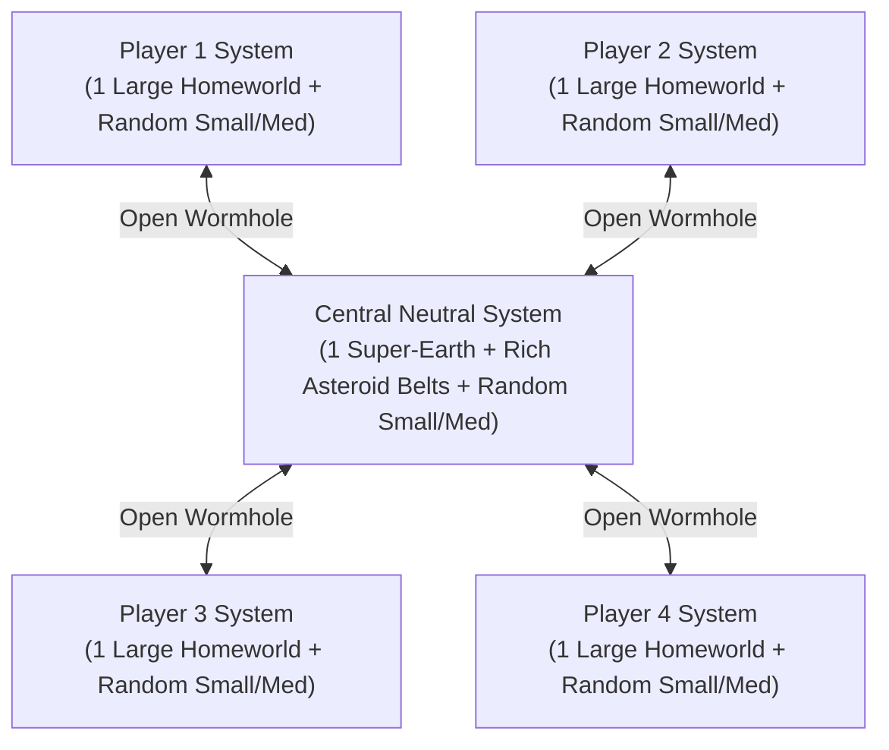
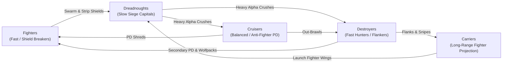
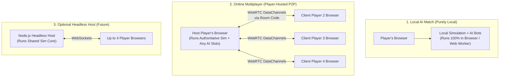

# StarConquest

> **Blueprint & Source of Truth**: This document is the canonical design and technical blueprint for **StarConquest**. Every gameplay system, balance rule, visual standard, and architectural decision is recorded here and must be kept up to date as the project evolves. All 3D ship and orbital platform art decisions, reference sheets, and modeling rules are held in [docs/artstyle.md](./docs/artstyle.md) and must be used whenever generating or updating 3D models.

**StarConquest** is a browser-based, 4-player real-time strategy (RTS) game set in deep space. Presented in a **2.5D/3D space view with an orbital camera**, it combines **macro-focused tug-of-war fleet command** with **orbital base management**, **spatial tower defence**, and a **5-class Rock-Paper-Scissors (RPS) combat loop**.

Rather than relying on high-APM individual unit micro, players focus on grand strategy: securing asymmetric resource lines, customizing planetary orbital rings, fortifying wormhole choke points, configuring production queues, and setting fleet rally points and patrol routes.

---

## 1. Core Gameplay Pillars

1. **Macro-Focused Tug-of-War RTS**: Players command fleets via rally points, patrol routes, and automated engagement stances rather than twitch micro-management.
2. **Orbital Ring Base Building**: Planets have a fixed number of orbital slots based on their size. Every slot matters—forcing meaningful trade-offs between economy, ship production, tech specialization, and planetary defense.
3. **Depleting Starter Belts & Forced Expansion**: All 4 starter systems begin with an identical, fair **Ore-heavy / Crystal-scarce** resource profile and finite tiered reserves whose inner Homeworld ring runs dry quickly, compelling players to expand into the contested **Central Nexus** (where enriched high-yield deposits await).
4. **Tactical Choke-Point Fortification**: Wormholes are open spatial corridors. Players project power around them using fragile Logistics Hubs that enable forward Defence Towers and Fighter operations.
5. **Tactical Rock-Paper-Scissors Combat**: Five distinct combat ship classes interact through a directional counter-matrix driven by weapon tracking, shields vs. hull mechanics, and fleet screening.

---

## 2. Galaxy Topology & Star Systems

A match supports up to **4 players** across **5 star systems** arranged in a hub-and-spoke layout:

### System Rules
* **Starter Systems (x4 — Identical Balanced Ore-Heavy / Crystal-Scarce Start)**:
  * Each player begins in a unique outer system containing a guaranteed **Large Homeworld** (10 orbital slots) and secondary **Small** (6 slots) and **Medium** (8 slots) planets.
  * Every starter system has the **exact same resource profile (`6,960` base Ore and `1,160` base Crystal — `6:1` Ore-to-Crystal ratio)** so all 4 players have an identical, fair start:
    * **Inner Homeworld Belt (`r ~ 420`)**: Fast-access early vein (`1,920` Ore and only `320` Crystal) that depletes within the first few minutes, forcing Harvesters away from the safety of the Homeworld C&C.
    * **Mid-System & Outer Pockets (`r ~ 1,120–1,620`)**: Mid-game reserves (`5,040` Ore and `840` Crystal) near the outer perimeter that also deplete as the game progresses.
    * Because **Crystals are strictly scarce in starter systems** (`1,160` total base Crystal), players can always build basic Ore-based defences and raiders at home, but **must venture outside their starter system** once local Crystals (or Ore) run dry to fund mid/late-game capital fleets (**Cruisers, Carriers, Dreadnoughts**) and **Hull Breaker Towers**.
* **Central Neutral System (x1 — Enriched High-Yield Hub)**:
  * A resource-rich contested hub anchored by a single **Super-Earth** (12 orbital slots) alongside secondary Small/Medium planets and massive, balanced asteroid belts (`22,800` base Ore and `22,800` base Crystal).
  * **Enriched High-Purity Deposits (`1.6x` Extraction Speed)**: Asteroid and Crystal clusters in the Central Nexus extract **`1.6x` faster** (`~7.8s` to fill a 40-unit Harvester cargo bay instead of `12.5s` in starter systems).
  * Always generates **4 wormholes**—one leading to each of the 4 player starter systems, even in matches with fewer than 4 human/AI players (allowing flanking or expansion into empty starter systems).
* **Wormholes & System Scale**:
  * Wormholes are **open spatial choke points** located on the outer perimeter of each star system (`1,850–2,050` units from the central planet), while secondary planets orbit `850–1,250+` units away in separate quadrants.
  * This wide spatial separation (`> 5x` structure sensor and weapon ranges) prevents instant firefights upon wormhole transit, gives fleets room to maneuver, and creates dark outer-rim corridors where **Harvesters and raiders can sneak past enemy sensor bubbles** to mine off-axis outer asteroid pockets without being detected.
  * Because any unit can transit freely, wormhole mouths are the primary flashpoints for forward **Logistics Hubs** and **Defence Towers**.

---

## 3. Economy & Resource Harvesting

### Resources
Resources are mined from asteroid belts scattered randomly throughout each star system:
* **Ore**: The foundational industrial resource. Primarily used for basic ship hulls (Fighters, Destroyers, Harvesters), basic orbital structures, and defensive towers.
* **Crystals**: The high-tech resource. Required for advanced capital ships (Cruisers, Carriers, Dreadnoughts), shield systems, heavy weaponry, and specialization modules.

### Refineries & Harvesters
* **Automated Harvesting**: Constructing a **Refinery** (or using the starting Command & Control's built-in drop-off) automatically provides **1 free Harvester**, with the option to queue additional Harvesters (`9s` build time, sequential 1-at-a-time queue capped at `5` orders; resources deducted upfront and refunded immediately if cancelled).
* **Mining Loop, Speeds & Single-Rock Lock**:
  * **Outward vs. Laden Speed**: Harvesters travel at `41.3 u/s` when empty (`-25%` from base cruise) and slow to `27.6 u/s` when full (`-50%` from base cruise), making laden Harvesters prime targets for raiders.
  * **12.5-Second Standard vs. 7.8-Second Enriched Extraction**: Each Harvester holds `40` Ore or Crystals per mining session. In starter systems (`1.0x` Standard Yield), extraction takes `12.5 seconds` (`3.2 u/s`); in the Central Nexus (`1.6x` Enriched Yield), high-purity deposits fill the 40-unit bay in **`~7.8 seconds`** (`5.12 u/s`). During extraction, the Harvester locks onto a **single specific Ore asteroid or Crystal cluster**, drifts alongside that rock as the belt rotates, and keeps its mining laser locked onto that rock's center.
  * **Visual Belt Depletion & Automatic Wormhole Expansion**: As a deposit's reserves are mined down, its 3D asteroid/crystal cluster visually shrinks and disappears completely when exhausted. Harvesters naturally deplete the nearby Inner Homeworld Belt (`r ~ 420`) first, then push out to the Mid/Outer pockets (`r ~ 1,120–1,620`), and **automatically transit the wormhole into the Central Nexus** once their starter system runs out of their target resource.
  * **Selection & Camera Pin**: Clicking any Harvester (or Planet) in 3D space or the HUD pins the camera to follow it and displays its target resource and live cargo progress (`x / 40`); panning manually with the mouse or `WASD` breaks the camera pin.
  * **Home Platform & Unload Rates**: Every Harvester docks directly at its originating **Refinery** (`10` units/sec unload) or **Command & Control** (`4` units/sec unload) orbital platform.
  * **Platform Docking Capacity (Queueing)**: A **Refinery** can unload **`2` Harvester frigates simultaneously** (`20/s` max), while a **Command & Control** is capped at **`1` concurrent Harvester dock** in Standard Tactical / Grand Conquest (`2` in **Blitz Skirmish**). Additional arriving Harvesters wait in a holding queue until a docking pad clears, making Refineries essential for scaling income.
  * **Platform Mining Focus**: Players can set each Refinery or C&C platform's mining target to **`Auto`**, **`Ore Only`**, or **`Crystal Only`**, directing all Harvesters assigned to that platform to focus on the needed resource.
  * **Fallback on Platform Destruction**: If a Harvester's assigned home platform is destroyed, it automatically reassigns to the closest friendly Refinery or C&C platform at the time of loss.
* **The Central Super-Earth Advantage**:
  * Mining in the Central Neutral System without a local base forces Harvesters to transit back through wormholes to their home system—making them slow and vulnerable to enemy raids.
  * Capturing the central **Super-Earth** (or a neutral secondary planet) and constructing a local **Refinery** allows Harvesters to process resources locally in the central hub, massively accelerating income.

---

## 4. Planetary Orbital Rings & Structures

Structures are built in a visible **orbital ring** around planets. Each planet class supports a maximum number of orbital slots:

| Planet Class | Orbital Slots | Typical Location |
| :--- | :---: | :--- |
| **Small Planet** | **6 Slots** | Randomized secondary planets in starter & central systems |
| **Medium Planet** | **8 Slots** | Randomized secondary planets in starter & central systems |
| **Large Planet** | **10 Slots** | Guaranteed starting Homeworld for each player |
| **Super-Earth** | **12 Slots** | Unique centerpiece of the Central Neutral System |

### Orbital Structure Types

| Structure | Slot Cost | Role & Mechanics |
| :--- | :---: | :--- |
| **Command & Control (C&C)** | **2 Slots** | **Unique Homeworld headquarters.** Massive HP pool, built-in basic resource drop-off, base Fleet Supply, and limited Point Defence turrets. **If a player's C&C is destroyed, they are defeated.** |
| **Planetary Outpost / Hub** | **1 Slot** | Required first structure to claim an unowned secondary planet (Small, Medium, or Super-Earth) and unlock its remaining orbital slots. |
| **Orbital Dockyard (Shipyard)** | **2 Slots** | Constructs combat ships via manual queues or **toggleable auto-repeat**. Players set rally points or patrol routes directly from Dockyards. Initial Dockyards only build basic craft until expanded via Tech Modules. |
| **Refinery** | **1 Slot** | Local drop-off and processing center for Ore and Crystals. Spawns 1 free Harvester on completion and can queue additional Harvesters. |
| **Tech / Specialization Module** | **1 Slot** | Orbital expansion modules that unlock advanced ship hulls (Cruisers, Carriers, Dreadnoughts), increase **Fleet Supply**, or grant doctrine bonuses (e.g., enhanced fighter bays, heavy siege calibration, shield boosters). |
| **Heavy Defense Platform / Shield** | **2 Slots** | Fortifies the planet's orbital ring with heavy batteries, figure-8 planetary shielding, and **3 remote-controlled perimeter sentry turrets** stationed around the far sides of the planet so hostile fleets never have a line-of-sight blind spot (if any gun has line of sight, full platform DPS applies; destroying the main platform destroys its remote sentry turrets). |

---

## 5. Deep-Space Logistics & Tower Defence

Outside of planetary rings, players cannot build structures freely in open space. Instead, they must project an operational tether using **Logistics Hubs**.

### Logistics Hubs
* **Role**: Forward deep-space support stations placed near wormholes, asteroid belts, or staging zones.
* **3D Click-to-Place Deployment (`BUILD_DEEP_SPACE_STRUCTURE`)**: Selecting **+ Place Logistics Hub** in the HUD enters interactive 3D placement mode, projecting a holographic wireframe preview of the **Atlas Logistics Hub** and its `180`-unit operational radius ring onto the star system's orbital plane (`y = 0`). Clicking any valid deep-space coordinate (clear of planetary orbital rings and other installations) deducts `250 Ore / 100 Crystal` and begins its `20s` construction.
* **Attributes**: Moderate resource cost, low hull/shield durability, and a generous **Build & Operational Radius (`180` units)**.
* **Functions**:
  1. **Tower Construction Radius**: Enables the placement of Defence Towers within its radius.
  2. **Fighter Operations**: Acts as a forward carrier base, allowing short-range **Fighters** to operate and refuel in the area.
  3. **Fleet Logistics**: Increases the player's **Fleet Supply cap** and provides slow out-of-combat hull repair to nearby friendly ships.
* **Tactical Counterplay**: Because Logistics Hubs have low durability compared to planetary bases, an attacker can either batter through the defensive towers with siege ships or snipe the Logistics Hub to disable/strand the surrounding defences and fighters.

### Defence Towers
Must be constructed within the radius of a friendly Logistics Hub:
* **Point Defence (PD) Tower**:
  * **High tracking, rapid fire, low alpha damage.**
  * Excels at shredding **Fighters** and fast **Destroyers**, and steadily chipping away at light shields.
* **Hull Breaker Tower**:
  * **Very low tracking, slow reload, massive alpha strike.**
  * Designed to punish slow-moving capital ships (**Dreadnoughts**, **Carriers**, **Cruisers**), dealing devastating structural damage once their shields are stripped.

---

## 6. Combat Mechanics & Ship Classes

### Shields vs. Hull System
* **Shields** are present only on **Cruisers, Carriers, Dreadnoughts, and Orbital Structures**. Shields absorb incoming damage and regenerate over time when out of combat.
* **Hull** is the permanent structural health of every unit and building. **Fighters and Destroyers are Hull-only**, relying on speed, small profiles, and evasion rather than shields.
* **Shield Breaking vs. Hull Breaking**:
  * **Fighters** are specialized **Shield Breakers**, dealing heavy bonus damage against shields.
  * Once a capital ship's shields collapse, heavy anti-ship weapons and **Hull Breaker Towers** tear through its underlying Hull.

### The 5-Class Combat Matrix

| Ship Class | Defences | Speed | Weapons & Tracking | Tactical Role & Matchups |
| :--- | :--- | :--- | :--- | :--- |
| **Fighters** | Hull Only *(Extremely Fragile)* | Very Fast | Light Shield-Breaker Blasters *(High Tracking)* | **Shield Breakers & Screens.** Require a **Logistics Hub** or **Carrier** to operate. Swarm and defeat **Dreadnoughts** via "death by a thousand cuts" (evading slow heavy turrets while stripping shields). Shredded by **Cruiser/Destroyer Point Defence**. **Fighter-vs-Fighter** dogfights include controlled evasion/crit randomness ("pilot skill/luck") so clashes aren't purely deterministic. |
| **Destroyers** | Hull Only *(Fragile)* | Fast | Medium Cannons + Light Point Defence | **Fast Hunters & Raiders.** Built to rush past frontlines to hunt **Carriers**, harass Harvesters, and flank isolated **Cruisers**. Secondary PD helps clear **Fighters**. Crushed by **Dreadnought** heavy salvos and out-brawled head-on by massed **Cruisers**. |
| **Cruisers** | Shields + Medium Hull | Medium | Heavy Point Defence Arrays + Moderate Heavy Weapons | **Fleet Backbone & Anti-Air Screen.** The premier screen against **Fighters** and **Carrier** wings, while strong enough to defeat **Destroyers** in standard engagements. Lacks the heavy firepower to trade against **Dreadnoughts** or break heavily fortified bases alone. |
| **Carriers** | Shields + Heavy Hull | Slow | Fighter Hangar Bays *(Minimal Direct Weapons)* | **Mobile Airbase & Standoff Support.** Operates, launches, and replenishes **Fighter** squadrons anywhere on the map without needing a Logistics Hub. Counters **Dreadnoughts** from afar, but is vulnerable if fast **Destroyers** close the gap or if **Cruisers** neutralize its Fighter wings. |
| **Dreadnoughts** | Heavy Shields + Massive Hull | Very Slow | Capital Siege Batteries *(Very Low Tracking, High Alpha)* | **Linebreaker & Base Siege.** Devastates **Cruisers**, **Destroyers**, **Logistics Hubs**, **Defence Towers**, and **Command & Control** stations. Helpless when swarmed by uncontested **Fighters** (which strip its shields and evade its guns), leaving it exposed to **Hull Breakers**. |

### Fleet Production & Command
* **Production & Supply**: Ships are queued at **Orbital Dockyards** using Ore and Crystals, with optional **auto-repeat** toggles for continuous tug-of-war reinforcement. Total fleet size is governed by a **Fleet Supply Cap**, expanded by building **Logistics Hubs** and **C&C Tech Modules**.
* **Macro Controls**: Players direct fleets by assigning **Rally Points**, **Patrol Routes** (e.g., guarding wormholes or escorting harvester lanes), and **Fleet Stances** (Aggressive Push, Hold Choke Point, Hunt Harvesters/Backline), letting fleets execute target-priority AI automatically in combat.

---

## 7. Match Modes & Lobby Presets

Before starting a game, players can select from three match presets tailored to different session lengths and strategic preferences:

1. **Blitz Skirmish (15–30 Minutes)**
   * **Economy**: Accelerated harvesting rates and lower initial structure costs.
   * **Visibility**: Open System Visibility (full vision in systems where you own a unit or structure; only unvisited systems are hidden).
   * **Victory Condition**: **Last Command & Control Standing**.
2. **Standard Tactical (20–40 Minutes)**
   * **Economy**: Standard harvesting and progression pacing.
   * **Visibility**: **Sensor-Range Fog of War** (visibility is strictly limited to the radar radius of friendly units, orbital structures, and Logistics Hubs).
   * **Victory Condition**: **Last Command & Control Standing**.
3. **Grand Conquest (45+ Minutes)**
   * **Economy**: Full strategic economy with larger asteroid reserves and extended tech scaling.
   * **Visibility**: **Sensor-Range Fog of War**.
   * **Victory Conditions**:
     * **Last Command & Control Standing**, OR
     * **King of the Hill**: Capture the Central Neutral System's **Super-Earth** and defend it continuously for a set countdown timer.

---

## 8. Visual Direction & Space Atmosphere

A core goal of **StarConquest** is delivering rich, atmospheric 2.5D/3D space visuals directly in the browser using **Three.js**, **custom GLSL shaders**, and **Selective HDR Bloom (`postprocessing`)**:

1. **Deep Space & Procedural Nebulae**:
   * Each of the 5 star systems features a distinct color palette and lighting mood (e.g., cyan/magenta emission nebula, golden dust expanse, crimson rift).
   * Backgrounds combine **multi-layered procedural FBM (Fractional Brownian Motion) noise shaders**, volumetric-style nebula billboards, and multi-depth parallax starfields.
2. **Multi-Layered Living Planets**:
   * **Terran / Earth & Super-Earth Worlds**:
     * **Surface Layer**: Custom PBR/GLSL shader with distinct continents, relief/normal mapping, and specular ocean reflections that catch the system's star light.
     * **Habitation & Cityscapes**: Inhabited worlds with orbital platforms (such as starter Homeworlds) render textured grey urban cityscapes on the sunlit side that transition seamlessly into glowing warm-amber city lights as they rotate onto the night side. Unclaimed worlds with no orbital platforms (such as the Central Nexus Super-Earth before a Planetary Outpost is built) remain uninhabited wilderness with no cities until claimed.
     * **Drifting Cloud Layer**: A secondary, slightly larger transparent sphere rotating at an independent speed with cloud coverage and subtle shadow projection onto the surface below.
     * **Atmospheric Halo**: An outer Fresnel rim-lighting shader shell giving the planet horizon a realistic atmospheric scatter (azure blue for Earth/Super-Earth worlds).
   * **Rock / Volcanic / Lava Worlds**:
     * **Surface Layer**: Rugged, cratered dark basalt rock with normal/roughness detail.
     * **Animated Magma Fissures**: Emissive procedural lava cracks and caldera pools that slowly pulse and flow using UV/noise distortion, glowing brightly through the HDR bloom pass.
     * **Scorched Atmosphere**: Warm orange/ember Fresnel rim haze.
3. **Orbital Rings, Wormholes & Combat VFX**:
   * **Orbital Rings**: Sleek orbital ring tracks around every planet (`src/client/renderer/planetFactory.ts`) with visible slot nodes (`6`, `8`, `10`, or `12` slots) on empty slots where stations can be constructed. Once a 1-slot or 2-slot platform occupies a slot (such as the 2-slot Command & Control flagship station on starter Homeworlds), its blue orbital build slot marker is automatically hidden so only genuinely free slots remain visible.
   * **Wormholes (DS9-Style Proximity Opening Event)**: Wormholes (`src/client/shaders/wormholeShader.ts` & `src/client/renderer/spaceEnvironmentFactory.ts`) rest as a compact, shimmering subspace anomaly marker when idle. When a ship approaches within proximity (`240` units—or when triggered from the HUD for inspection), the wormhole erupts with a Deep Space 9-inspired gravimetric cross-flare and shockwave ring before unfurling into a 3D depth-displaced swirling cloud funnel and luminous tunnel throat.
   * **Selective HDR Bloom & Instancing**: HDR bloom illuminates ship engine trails, weapon salvos (rapid Point Defence tracers vs. heavy Hull Breaker plasma/rail shots), shield impact ripples, and planetary lava. Asteroid belts (`src/client/renderer/spaceEnvironmentFactory.ts`), Fighter squadrons, and projectiles use `THREE.InstancedMesh` to sustain 60 FPS.
4. **Orbital Camera & Sector Navigation (`src/client/renderer/orbitalCamera.ts` & `src/client/ui/systemHud.ts`)**:
   * **Pan**: Left-drag, middle-drag, or `WASD` / Arrow keys across the star system plane.
   * **Orbit & Tilt**: Right-drag to rotate azimuth and polar viewing angles.
   * **Zoom & Planet Focus**: Mouse wheel zooms smoothly from system-wide tactical overview down to close-up planetary surface/cloud inspection; clicking any planet or system in the HUD smoothly glides the camera to that target.
5. **Ship & Orbital Platform 3D Art Style ([docs/artstyle.md](./docs/artstyle.md))**:
   * All 3D ship and orbital platform models follow the **Grounded Industrial Space Opera** style guide and master material palette defined in [docs/artstyle.md](./docs/artstyle.md) (gunmetal slate `#3e4652`, weathered ochre `#c27d2c`, dark charcoal iron `#1e232a` ribbing, warm amber `#fbbf24` bridges, and cool cyan `#38bdf8` / amber `#f59e0b` containment & thruster lighting).
   * Whenever generating or modifying any ship or orbital platform model, always consult and update [docs/artstyle.md](./docs/artstyle.md), building and approving one model at a time.

---

## 9. Technical Architecture, Local AI & P2P Multiplayer

### Tech Stack
* **Language & Tooling**: **TypeScript (Strict Mode)** + **Vite** (HMR & GLSL shader bundling) + **Vitest** (unit & headless balance tests).
* **Rendering**: **Three.js** + **`postprocessing`** with a decoupled HTML/CSS tactical HUD overlay (`src/client/ui/systemHud.ts`) and 3D Harvester fleet renderer (`src/client/renderer/harvesterFleetRenderer.ts`).
* **Simulation Core (`src/shared/sim/gameSimulation.ts`)**: A pure TypeScript, fixed-tick authoritative simulation engine and AI bot controller (`src/shared/ai/aiController.ts`) with zero rendering or DOM dependencies, managing orbital ring slot construction (`1-slot` vs. `2-slot` occupancy, secondary planet `Planetary Outpost` claiming), Ore/Crystal stockpiles, Fleet Supply, and automated Harvester mining/wormhole transit loops.

### Hosting & Networking Model
Because the simulation core is **transport-agnostic** and interacts with players and AI exclusively via serializable `GameCommand` actions and `StateSnapshot` updates, the game supports three execution modes from the same codebase:

1. **Local vs. AI Matches (100% Local in Browser)**:
   * Runs **purely locally** inside the user's browser (main thread or Web Worker) via `LocalSimAdapter`.
   * Requires **zero servers and zero network traffic**—ideal for instant play, offline play, and rapid AI/balance tuning.
2. **Online Multiplayer (Player-Hosted P2P via WebRTC)**:
   * One player creates a match and acts as the **Authoritative Listen-Server Host** directly in their browser.
   * Up to 3 other human players join peer-to-peer using a short **Room Code** over **WebRTC DataChannels** (with any remaining slots filled by AI bots running on the host).
   * Eliminates the need to run or pay for dedicated game simulation servers while keeping latency smooth for macro-focused RTS controls.
3. **Optional Dedicated Headless Host (Future-Proofed)**:
   * Because `src/shared/sim` has no browser dependencies, it can also be wrapped in a lightweight Node.js WebSocket server later if public matchmaking or dedicated rooms are ever desired.

---

## 10. Initial Baseline Balance Tables (`src/shared/config/`)

All balance numbers live in `src/shared/config/` for rapid tuning and headless testing:

### Ship Class Baseline Stats (`src/shared/config/ships.ts`)

| Ship Class | Cost (Ore / Crystal) | Build Time | Supply | Shields (Regen/s) | Hull | Speed | Evasion | Special Rules |
| :--- | :---: | :---: | :---: | :---: | :---: | :---: | :---: | :--- |
| **Fighter Squadron** | 60 / 15 | 7s | 1 | 0 *(Hull Only)* | 110 | 95 | 0.85 | Requires Carrier/Hub; `2.5x` Shield Damage; `±25%` dogfight luck variance |
| **Destroyer** | 140 / 40 | 12s | 2 | 0 *(Hull Only)* | 420 | 68 | 0.55 | Medium guns (`1.35x` Hull mult) + light Flak PD |
| **Cruiser** | 260 / 140 | 20s | 4 | 450 (`8/s`) | 750 | 44 | 0.30 | Requires 1 Tech Module; Rapid PD (`0.96` tracking) + Dual Heavy Turrets |
| **Fleet Carrier** | 380 / 320 | 30s | 6 | 700 (`10/s`) | 1,100 | 28 | 0.15 | Requires 2 Tech Modules; supports 4 Fighter Squadrons anywhere |
| **Dreadnought** | 550 / 480 | 38s | 8 | 1,400 (`14/s`) | 2,400 | 18 | 0.05 | Requires 2 Tech Modules; Spinal Siege Batteries (`280` alpha, `0.18` tracking) |
| **Resource Harvester** | 100 / 20 | 9s | 0 | 0 *(Hull Only)* | 300 | 41.3 / 27.6 | 0.20 | 1 spawned free with C&C and each Refinery; `40` cargo (`12.5s` mine), max queue `5` |

### Deep-Space Structures (`src/shared/config/structures.ts`)

| Structure | Cost (Ore / Crystal) | Build Time | Shields / Hull | Special / Weapon Profile |
| :--- | :---: | :---: | :---: | :--- |
| **Logistics Hub** | 250 / 100 | 20s | 500 / 900 | `180` Build Radius, Fighter Operations staging, `+15` Fleet Supply |
| **Point Defence Tower** | 150 / 50 | 14s | 400 / 850 | Requires Hub Radius; `0.95` tracking, `18` alpha every `0.35s` |
| **Hull Breaker Tower** | 220 / 180 | 22s | 600 / 1,200 | Requires Hub Radius; `0.15` tracking, `320` alpha every `3.5s` |

---

## 11. Development, Build Commands & Git Workflow

### Project Commands
* `npm install` — Install dependencies (`three`, `postprocessing`, `vite`, `vitest`, `typescript`).
* `npm run dev` — Start the Vite development server at `http://localhost:5173` (`base: '/'`).
* `npm run build` — Run strict TypeScript typechecking (`tsc --noEmit`) and bundle for production (`vite build`, using `base: '/StarConquest/'` in `vite.config.ts` for GitHub Pages static asset resolution).
* `npm test` — Execute the Vitest unit and balance invariant test suite (`vitest run`).

### Git Branching & Pull Request Rules
* **Focused Topic Branches**: All new work must be done on a dedicated branch named after the specific feature, bug, or task being worked on:
  * `feature/<descriptive-name>` (e.g., `feature/planetary-shaders`, `feature/orbital-ring-slots`)
  * `fix/<descriptive-name>` (e.g., `fix/harvester-wormhole-pathing`)
  * `task/<descriptive-name>` (e.g., `task/scaffold-vite-three`)
* **Pre-Commit Verification**: Code must compile cleanly (`npm run build`) and pass all unit tests (`npm test`) prior to every commit on the working branch.
* **Human PR Approval**: All Pull Requests require human review and approval before merging into `main`.

---

## 12. Feature Roadmap, Future Work & Known Bug Fixes

### Planned Feature Execution Order
1. ~~**HUD & Wormhole UX Quick-Win (`fix/hud-harvester-and-wormhole-ux`)**~~ *(Completed)*: Moved assigned Harvesters out of the top HUD bar into each selected C&C / Refinery panel beside its `Auto` / `Ore` / `Crystal` Mining Focus controls, and made HUD wormhole clicks focus the camera only without triggering a false opening animation.
2. ~~**5 Combat Ship 3D Models Art Pass (`feature/combat-ship-models`)**~~ *(Completed)*: Built all 5 combat ship models (**Stinger Light Fighter**, **Havoc Destroyer**, **Cruiser**, **Vanguard Fleet Carrier**, and **Imperator Dreadnought**) in `src/client/renderer/shipModels.ts` and `docs/artstyle.md`, and replaced every placeholder proxy hull in the Atlas Logistics Hub bays, Titan Orbital Dockyard slipways/alcoves, and Minerva Tech Module holo-tables.
3. ~~**Combat Fleet Production, Navigation & Planetary Obstacle Avoidance (`feature/fleet-navigation`)**~~ *(Completed)*: Implemented the shared 2D planetary obstacle-avoidance steering and wormhole routing solver (`src/shared/sim/navigation.ts`) for both Harvesters and combat ships, Orbital Dockyard combat ship production queues with `autoRepeat`, tech/hub/supply gating, cross-system Rally Points, multi-waypoint Patrol Routes, 3D `CombatFleetRenderer` with Rally/Patrol overlays, and Orbital Dockyard HUD fleet controls.
4. **Combat RPS Simulation, Turret Tracking & Shield VFX (`feature/combat-and-vfx`)**: Implement the 5-class Shield vs. Hull RPS combat math, Fleet Stances, Carrier/Hub fighter tether rules, active target-tracking rotation for Defence Tower `turretPivots`, weapon tracers/salvos, and the dedicated Shield impact VFX art pass.
5. **Pre-Match Lobby & AI Opponents (`feature/lobby-and-ai`)**: Build the pre-match mode selector (Blitz Skirmish, Standard Tactical, Grand Conquest) with configurable Human/AI slots and `GameCommand`-driven AI bots for full 4-player local matches.
6. **In-Game Codex / Wiki & Interactive 3D Model Viewer (`feature/ingame-codex-wiki`)**: Add an in-game encyclopaedia documenting every ship, orbital platform, deep-space installation, how-to-play mechanics, and victory goals, complete with an interactive 3D preview viewport (orbit, zoom, and pan) rendering live models from `ShipModelLibrary` and `StationModelLibrary` alongside live data-driven stats from `src/shared/config/`.

### Shield Visual Effects & Energized Hull Plating Art Pass
* **Planned Art Pass**: Static always-on shield meshes were removed from both the **Aegis Heavy Orbital Defense Platform** and the **Atlas Deep-Space Logistics Hub**. No shield meshes or effects should be rendered on any platform or ship until a dedicated Shield VFX art pass decides whether shields render dynamically only on weapon impact ripples or as energized hull plating along armor seams.

### In-Game Codex / Wiki & Interactive 3D Model Viewer
* **Planned Feature (`feature/ingame-codex-wiki`)**: Build an in-game wiki/codex overlay accessible from the tactical HUD and pre-match lobby with:
  * **Interactive 3D Preview Viewport**: Renders any ship (`ShipModelLibrary`) or orbital/deep-space platform (`StationModelLibrary`) in a dedicated Three.js inspection canvas supporting full **orbit, zoom, and pan** camera controls (matching the main world camera).
  * **Live Data-Driven Unit & Structure Reference**: Automatically pulls costs, slot requirements, shields, hull, speed, tracking, RPS counters, and build times directly from `src/shared/config/` so stats never drift out of sync with balance changes.
  * **How to Play & Victory Goals Guide**: Clear player-facing overview of the 5-system hub-and-spoke galaxy, Ore/Crystal scarcity & Central Nexus escalation, macro fleet stances/rally/patrol controls, and mode-specific victory conditions (Last C&C Standing & Grand Conquest King of the Hill).
