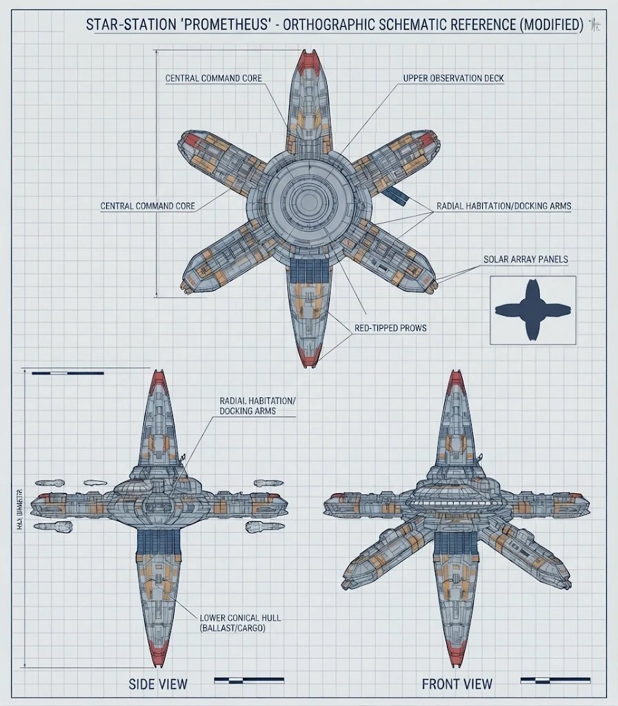
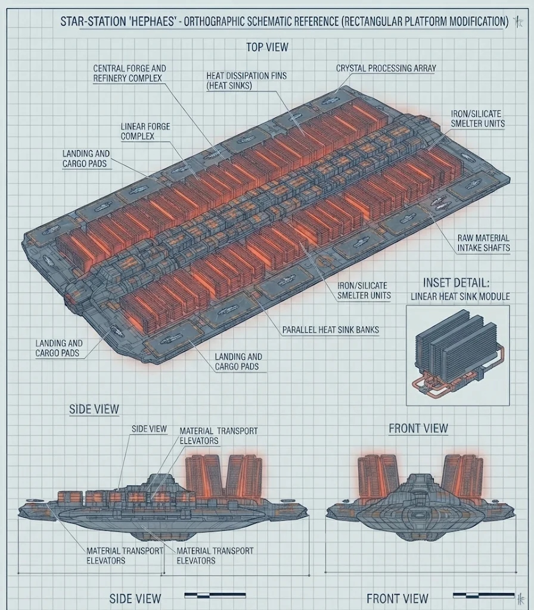

# StarConquest — 3D Art Style & Model Construction Guide

> **Mandatory Art & Modeling Reference**: This document defines the canonical visual style, color/material palette, and 3D procedural construction rules for all ships and orbital platforms in **StarConquest**. Every new or updated 3D model must follow these rules and be documented here as each ship and platform is approved one at a time.

---

## 1. Visual Identity: "Grounded Industrial Space Opera"

**StarConquest** ships and orbital platforms follow a **grounded, heavy-industrial sci-fi aesthetic**:
* **Functional Silhouette & Modularity**: Every vessel and station looks engineered for deep-space industry or naval combat—built from chamfered armor hull sections, exposed dark structural ribbing, modular external pods, sensor masts, and clustered thruster bells.
* **High-Contrast Material Readability**: Models combine matte/satin **gunmetal slate armor** with **weathered ochre/amber industrial paneling** and **dark charcoal mechanical frames**, punctuated by **warm amber cockpit windows** and **cool cyan-blue containment/thruster glow**.
* **Controlled HDR Bloom**: Emissive surfaces (cabin windows, cargo containment slits, sensor strips) are kept at moderate intensity (`0.5–0.9`) so they read crisply without washing out the hull, while **HDR bloom (`> 1.1`)** is reserved for active weapon/mining beams, molten impact sparks, and thruster exhaust cores.

---

## 2. Master Color & PBR Material Palette

To ensure every ship and orbital platform shares a cohesive visual language across the game, all 3D models must use this standardized material palette:

| Material Role | Hex Color | Metalness | Roughness | Emissive / Special Notes |
| :--- | :---: | :---: | :---: | :--- |
| **Primary Hull Armor (Gunmetal Slate)** | `#3e4652` | `0.68` | `0.42` | Main fuselage spine, outer nacelle casings, primary armor plates |
| **Secondary Accent Armor (Weathered Ochre / Amber)** | `#c27d2c` | `0.55` | `0.48` | Forward cheek armor, engine cowlings, industrial hazard panels |
| **Structural Frame & Ribs (Dark Charcoal Iron)** | `#1e232a` | `0.78` | `0.35` | Cargo pod rib bands, wing pylons, drill barrels, landing gear, turret rings |
| **Trim & Mechanical Detail (Steel Grey)** | `#64748b` | `0.75` | `0.32` | Piston rods, dorsal hatches, muzzle collars, antenna masts |
| **Cockpit / Bridge Interior (Warm Cabin Amber)** | `#fbbf24` | `0.15` | `0.20` | Emissive `#d97706` (`0.85` intensity) behind dark canopy frame struts |
| **Crystal / Ion Containment Glow (Subspace Cyan)** | `#38bdf8` | `0.20` | `0.18` | Emissive `#0284c7` (`0.75` intensity) for cargo pod windows & intake slits |
| **Ore Containment / Molten Glow (Warm Industrial Amber)** | `#f59e0b` | `0.20` | `0.22` | Emissive `#b45309` (`0.75` intensity) when cargo pods carry Ore |
| **Thruster Exhaust Core (Ion Blue-White)** | `#7dd3fc` | — | — | `MeshBasicMaterial` (`[0.35, 0.85, 1.35]`) inside dark thruster nozzle bells |
| **Navigation / Antenna Beacon (Signal Red)** | `#ef4444` | — | — | Small pinpoint beacon at the tip of dorsal communication masts |
| **Station Prow / Spire Tip Accent (Crimson Oxide)** | `#b91c1c` | `0.45` | `0.50` | Weathered red-tipped prows on radial docking arms and command spires |
| **Solar Array Panels (Deep Photovoltaic Blue)** | `#1e3a5f` | `0.65` | `0.25` | Solar collector wings with subtle dark structural frame borders |
| **Forge Heat-Sink Glow (Molten Copper-Orange)** | `#fb923c` | `0.25` | `0.25` | Emissive `#ea580c` (`0.95` intensity) between dark radiator fins on Refinery banks |

---

## 3. Procedural 3D Model Construction Rules

When building ships (`src/client/renderer/`) and orbital platforms (`src/client/renderer/planetFactory.ts`) in Three.js, follow these five construction rules:

1. **Multi-Part Functional Sub-Assemblies (Never Single Primitives)**:
   * Never represent a ship or station with a single box, sphere, or cylinder.
   * Construct each model as a `THREE.Group` composed of distinct architectural layers:
     1. **Core Hull Spine**: Tapered/chamfered central fuselage (`Primary Gunmetal Slate #3e4652`).
     2. **Accent Armor Panels**: Raised cheek/shoulder/cowling plates (`Weathered Ochre #c27d2c`) that break up large hull surfaces.
     3. **Structural Ribbing & Frames**: Dark `#1e232a` straps, collars, and trusses that visually bind pods and wings to the main hull.
     4. **Framed Bridge / Cockpit Canopy**: Recessed glowing warm-amber cabin windows (`#fbbf24`) framed by dark structural canopy bars, plus a dorsal hatch and antenna mast.
     5. **Propulsion & Utility Gear**: Multi-nozzle rear engine clusters (dark outer bells with inset glowing ion cores), outboard stabilizer nacelles, and ventral skids/sensors.
2. **Dynamic State Feedback on the Model**:
   * Models must visually reflect their live simulation state (e.g., the Harvester's 8 side cargo pods dynamically illuminate and scale their containment glow as cargo fills from `0` to `40`, and its nose mining drill articulates toward the target asteroid).
3. **Dual-Layer Beams & Surface Impact VFX**:
   * Energy beams (such as the Harvester's mining laser) must use a **tight high-energy inner core** (`#e0f2fe` / `#38bdf8`) surrounded by a **wider translucent outer plasma sheath** (`#f59e0b` / `#ea580c`), terminating in a **molten impact flare and debris ring** on the target surface.

---

## 4. Approved Model Blueprints

Each ship and orbital platform is designed and locked in one at a time.

### 01. Resource Harvester — Mining Frigate "Prospector"

* **Concept Reference**: 
* **Orthographic Blueprint**: 
* **Renderer Implementation**: [harvesterFleetRenderer.ts](../src/client/renderer/harvesterFleetRenderer.ts)

#### Anatomical Breakdown ("Prospector" Class)
1. **Forward Hull & Articulating Mining Drill (`+Z` Nose)**:
   * Tapered gunmetal nose housing flanked by weathered ochre-amber cheek armor plates and forward pinpoint spotlights.
   * **Articulating Mining Drill Assembly**: Multi-stage stepped dark-iron cylindrical drill barrel extending from the nose with upper and lower stabilizer prongs, a glowing cyan muzzle ring, and pitch/yaw articulation that tracks the target asteroid.
2. **Elevated Cockpit Module & Dorsal Spine**:
   * Trapezoidal raised bridge module behind the nose with warm amber-lit cabin windows (`#fbbf24`) separated by dark canopy frame struts.
   * Overhead twin floodlight blisters, a circular dorsal maintenance hatch on the mid-spine, and a vertical communications antenna with a red tip beacon.
3. **2x2 Port & Starboard Ribbed Cargo Pods (8 Pods Total)**:
   * Four modular industrial cargo pods mounted on the port flank (2 upper, 2 lower) and four on the starboard flank (2 upper, 2 lower).
   * Each pod features a gunmetal casing wrapped in three dark charcoal structural rib straps (`#1e232a`) and glowing side containment windows (`#38bdf8` cyan for Crystal / `#f59e0b` amber for Ore) whose brightness and fill reflect current mined cargo (`0–40`).
4. **Outboard Wing Pylons & Thruster Nacelles**:
   * Horizontal structural wing struts extending left and right between the upper and lower cargo pod rows.
   * Terminates in heavy outboard thruster nacelles (gunmetal + ochre cowling) with forward cyan intake slits, rear thruster nozzles, and underslung cylindrical auxiliary pods.
5. **Rear Engine Cluster & Ventral Landing Gear (`-Z` Stern)**:
   * Ochre-armored stern engine block housing a `2x2` / quad cluster of heavy industrial thruster bells with glowing cyan-blue ion exhaust cores.
   * Three ventral landing/utility gear struts (1 forward beneath the chin, 2 aft beneath the rear hull) matching the side-profile orthographic blueprint.
6. **Dual-Layer Mining Laser & Asteroid Impact Spark**:
   * Inner bright cyan-white core beam + outer warm orange-amber plasma sheath (`AdditiveBlending`), plus a glowing molten rock impact flare and spark ring at the exact point where the beam strikes the target asteroid or crystal cluster.

---

### 02. Command & Control (C&C) — Star-Station "Prometheus"

* **Concept Reference**: 
* **Orthographic Blueprint**: 
* **Renderer Implementation**: [stationModels.ts](../src/client/renderer/stationModels.ts) (used by [planetFactory.ts](../src/client/renderer/planetFactory.ts))

#### Anatomical Breakdown & Orbital Clearance Rules
1. **Planetary Clearance Constraint (Never Clip Planet or Atmosphere)**:
   * On a Large Homeworld (`radius = 28`, atmosphere `31.5`), the orbital ring sits at `42.56` units (`11.06` units clear of the atmosphere).
   * The "Prometheus" C&C is sized so its horizontal radial docking arms extend at most `7.2` units from the station center—leaving a clean `3.8+` unit deep-space gap from the planet's outer atmosphere halo, while its vertical upper spire (`+Y`) and lower conical ballast hull (`-Y`) rise and descend perpendicular to the orbital plane.
2. **Central Command Core & Upper Observation Deck**:
   * Multi-tiered stepped octagonal/cylindrical central hub in Gunmetal Slate (`#3e4652`) bound by Dark Charcoal (`#1e232a`) structural collars.
   * **Upper Observation Deck**: Panoramic wrap-around angled bridge ring with glowing cyan-white/warm-amber observation windows (`#38bdf8` / `#fbbf24`) segmented by dark structural mullions, topped by communications dishes and a red-tipped sensor mast.
3. **Upper Command Spire (`+Y`) & Lower Conical Ballast Hull (`-Y`)**:
   * Tall tapered octagonal spire rising above the central command core with Weathered Ochre (`#c27d2c`) armor panels, dark ribbing, and a **Crimson Oxide (`#b91c1c`)** tipped prow.
   * Matching tapered lower conical ballast/cargo hull descending below the hub (`-Y`) with a dark ribbed neck collar, ochre paneling, and a crimson-tipped lower prow.
4. **4 Main Horizontal Radial Arms + 2 Angled Ventral Docking Arms**:
   * Four heavy radial habitation/docking arms (`±X`, `±Z`) plus two ventral docking arms angled downward-outward (`±Z` tangent plane so they never angle toward the planet).
   * Each arm features stepped gunmetal armor, ochre industrial plates, dark structural rib bands, recessed docking bay openings, glowing observation slit windows, and crimson-tipped prows.
5. **Solar Array Panels & Point Defence Turrets**:
   * Deep Photovoltaic Blue (`#1e3a5f`) solar array wings projecting from the mid-collar, plus twin dorsal Point Defence turret mounts.

---

### 03. Orbital Refinery — Star-Station "Hephaes"

* **Orthographic Blueprint**: 
* **Renderer Implementation**: [stationModels.ts](../src/client/renderer/stationModels.ts) (used by [planetFactory.ts](../src/client/renderer/planetFactory.ts))

#### Anatomical Breakdown & Orbital Arc Curvature
1. **Orbital Ring Arc Curvature (1-Slot Footprint)**:
   * Rather than a rigid flat rectangle, the "Hephaes" platform (`~14.5u` arc length × `~6.8u` radial width) is segmented and **bent along the host planet's exact `orbitalRingRadius`** so its spine, deck aprons, and heat-sink rows follow the orbital ring track seamlessly without overlapping adjacent slots.
2. **Central Linear Forge Spine & Ventral Material Transport Elevators**:
   * Stepped Gunmetal Slate (`#3e4652`) central spine running along the curved arc, crowned by a central refinery control tower and underpinned by a tapered ventral cargo/elevator keel (`-Y`).
3. **Parallel Glowing Heat-Sink Banks (Iron/Silicate Smelters)**:
   * Twin rows of parallel, slightly V-canted radiator fin banks flanking the central spine. Dark Charcoal Iron (`#1e232a`) fin plates frame glowing **Molten Copper-Orange (`#fb923c` / emissive `#ea580c`)** smelter cores, matching the signature thermal glow in the schematic.
4. **Flanking Landing & Cargo Pads + Crystal Processing Array**:
   * Outer deck aprons along both sides of the heat-sink banks feature recessed Harvester landing/cargo pads with subtle cyan/amber beacon strips, plus a Crystal Processing Array at the end of the central spine.
