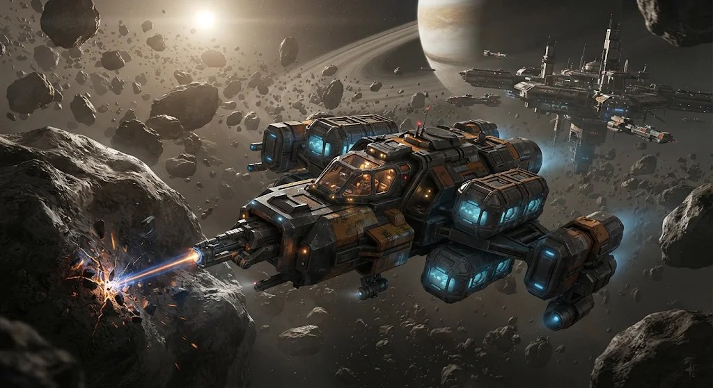
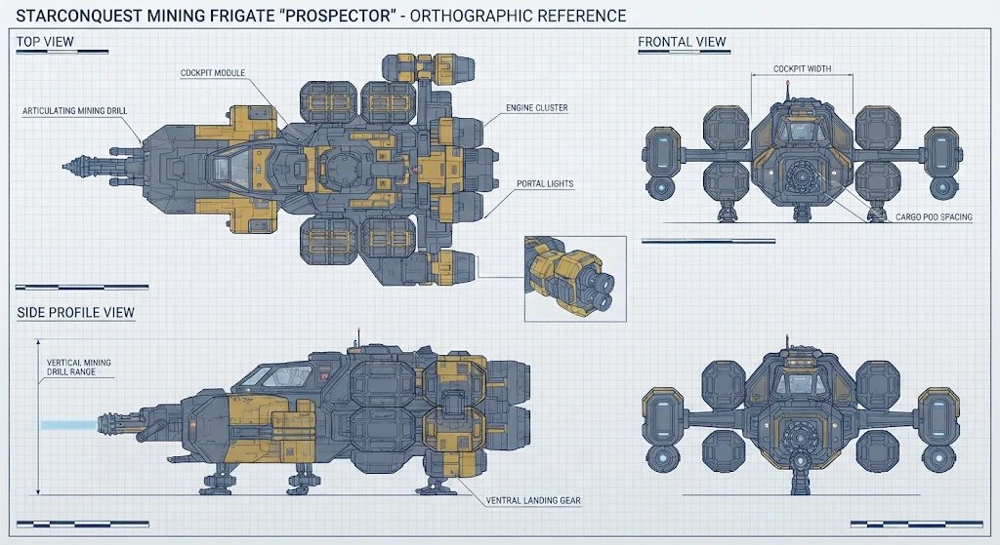
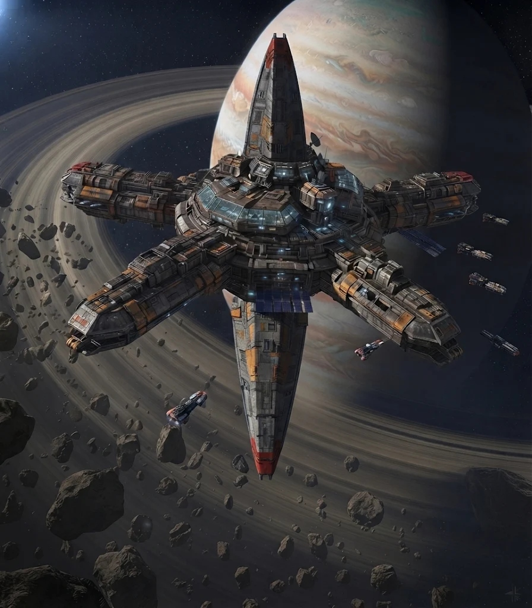
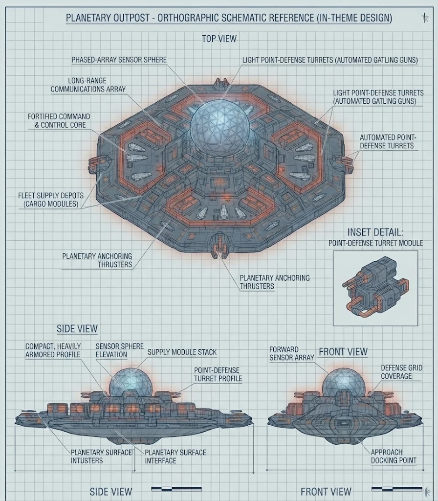
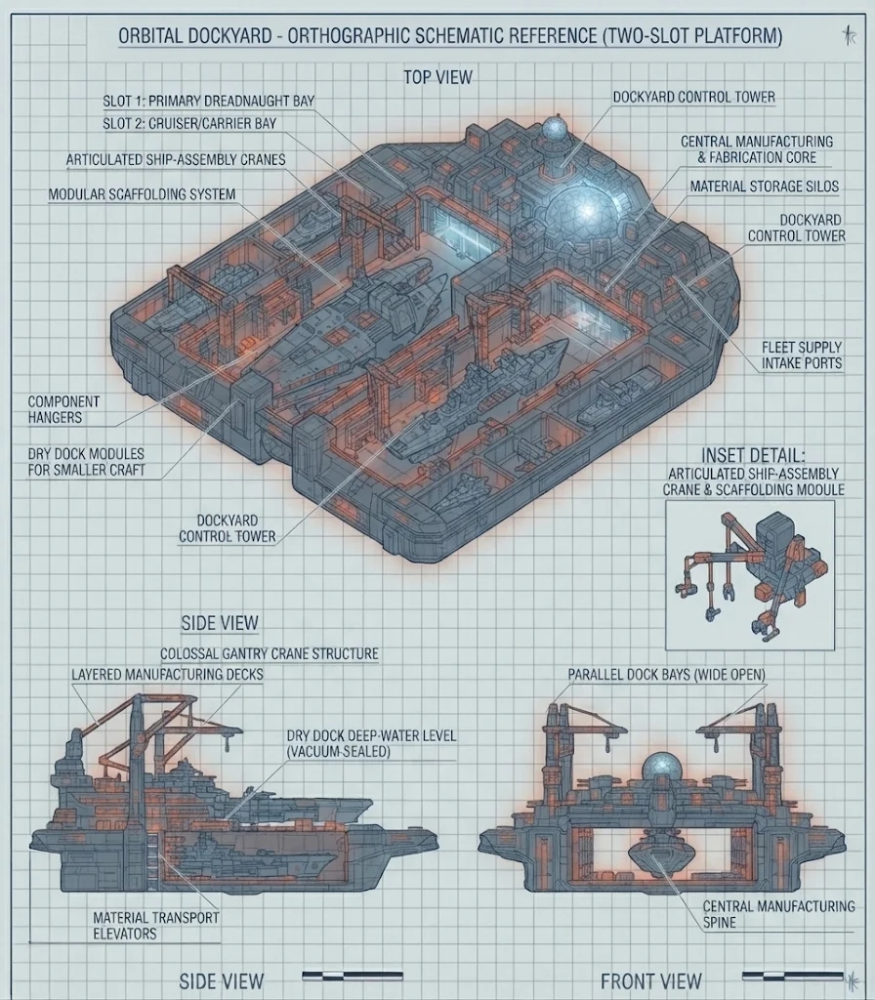
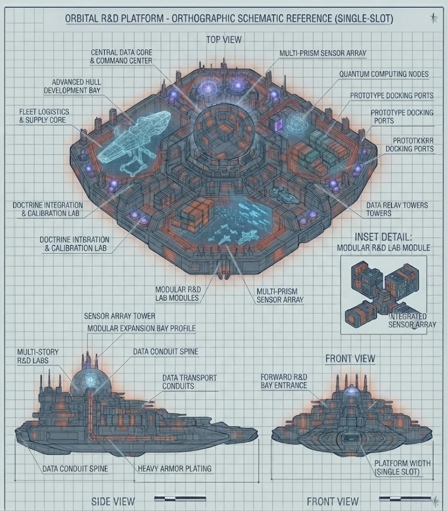
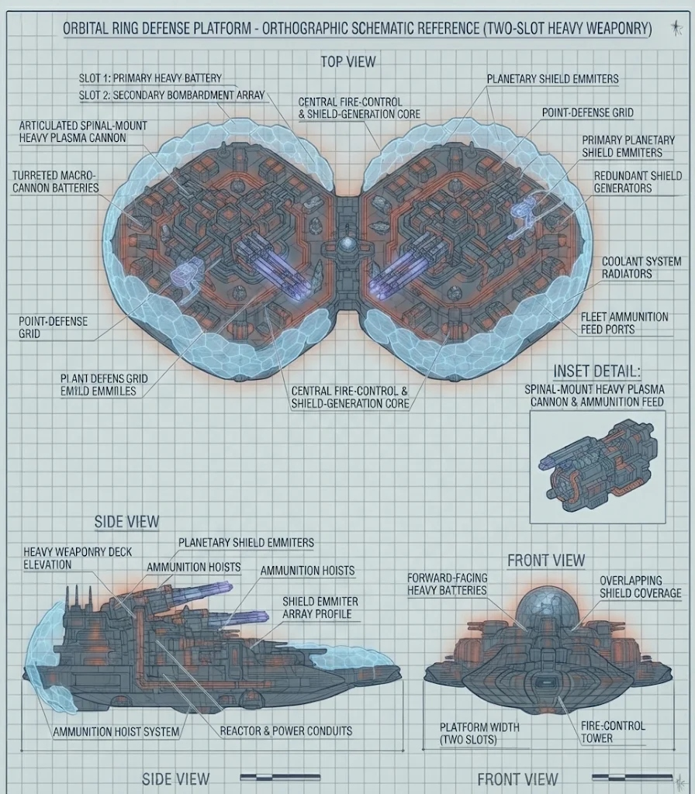
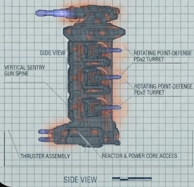
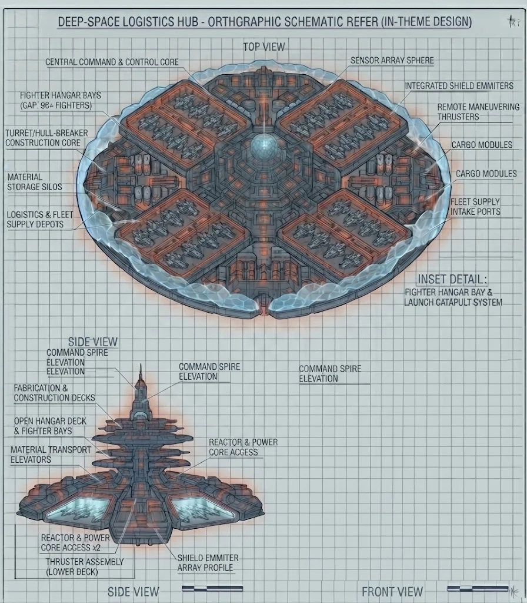

# StarConquest — 3D Art Style & Model Construction Guide

> **Mandatory Art & Modeling Reference**: This document defines the canonical visual style, color/material palette, and 3D procedural construction rules for all ships and orbital platforms in **StarConquest**. Every new or updated 3D model must follow these rules and be documented here as each ship and platform is approved one at a time.

---

## 1. Visual Identity: "Grounded Industrial Space Opera"

**StarConquest** ships and orbital platforms follow a **grounded, heavy-industrial sci-fi aesthetic**:
* **Functional Silhouette & Modularity**: Every vessel and station looks engineered for deep-space industry or naval combat—built from chamfered armor hull sections, exposed dark structural ribbing, modular external pods, sensor masts, and clustered thruster bells.
* **High-Contrast Material Readability & Procedural PBR Surface Detail**: Models combine matte/satin **gunmetal slate armor** with **weathered ochre/amber industrial paneling**, **dark charcoal mechanical frames**, and **machined steel grey weapon barrels** (`#8492a6`), punctuated by **warm amber cockpit windows** and **cool cyan-blue containment/thruster glow**. All primary hull, ochre, structural ribbing, and machined steel materials use deterministic procedural PBR textures (`src/client/renderer/proceduralHullTextures.ts`: albedo panel variation, recessed seams, rivets, weathering streaks, bump relief, and roughness breakup) so large stations and ships never read as flat mono-colored meshes.
* **Controlled HDR Bloom**: Emissive surfaces (cabin windows, cargo containment slits, sensor strips) are kept at moderate intensity (`0.5–0.9`) so they read crisply without washing out the hull, while **HDR bloom (`> 1.1`)** is reserved for active weapon/mining beams, molten impact sparks, and thruster exhaust cores.

---

## 2. Master Color & PBR Material Palette

To ensure every ship and orbital platform shares a cohesive visual language across the game, all 3D models must use this standardized material palette:

| Material Role | Hex Color | Metalness | Roughness | Emissive / Special Notes |
| :--- | :---: | :---: | :---: | :--- |
| **Primary Hull Armor (Gunmetal Slate)** | `#3e4652` | `0.68` | `0.42` | Main fuselage spine, outer nacelle casings, primary armor plates |
| **Secondary Accent Armor (Weathered Ochre / Amber)** | `#c27d2c` | `0.55` | `0.48` | Forward cheek armor, engine cowlings, industrial hazard panels |
| **Structural Frame & Ribs (Dark Charcoal Iron)** | `#1e232a` | `0.78` | `0.35` | Cargo pod rib bands, wing pylons, drill barrels, landing gear, turret rings |
| **Trim & Mechanical Detail (Steel Grey)** | `#64748b` | `0.76` | `0.48` | Piston rods, dorsal hatches, muzzle collars, antenna masts (brushed steel PBR map) |
| **Weapon & Turret Barrels (Machined Gunmetal Steel)** | `#8492a6` | `0.84` | `0.38` | All orbital & deep-space turret barrels (brushed metallic steel PBR map, never violet) |
| **Cockpit / Bridge Interior (Warm Cabin Amber)** | `#fbbf24` | `0.15` | `0.20` | Emissive `#d97706` (`0.85` intensity) behind dark canopy frame struts |
| **Crystal / Ion Containment Glow (Subspace Cyan)** | `#38bdf8` | `0.20` | `0.18` | Emissive `#0284c7` (`0.75` intensity) for cargo pod windows & intake slits |
| **Ore Containment / Molten Glow (Warm Industrial Amber)** | `#f59e0b` | `0.20` | `0.22` | Emissive `#b45309` (`0.75` intensity) when cargo pods carry Ore |
| **Thruster Exhaust Core (Ion Blue-White)** | `#7dd3fc` | — | — | `MeshBasicMaterial` (`[0.35, 0.85, 1.35]`) inside dark thruster nozzle bells |
| **Navigation / Antenna Beacon (Signal Red)** | `#ef4444` | — | — | Small pinpoint beacon at the tip of dorsal communication masts |
| **Station Prow / Spire Tip Accent (Crimson Oxide)** | `#b91c1c` | `0.45` | `0.50` | Weathered red-tipped prows on radial docking arms and command spires |
| **Solar Array Panels (Deep Photovoltaic Blue)** | `#1e3a5f` | `0.65` | `0.25` | Solar collector wings with subtle dark structural frame borders |
| **Forge Heat-Sink Glow (Molten Copper-Orange)** | `#fb923c` | `0.25` | `0.25` | Emissive `#ea580c` (`0.95` intensity) between dark radiator fins on Refinery banks |
| **Quantum R&D Prism Glow (Quantum Violet-Indigo)** | `#c084fc` | `0.25` | `0.20` | Emissive `#7e22ce` (`0.95` intensity) for R&D multi-prism sensor nodes & quantum data cores |

---

## 3. Procedural 3D Model Construction Rules

When building ships (`src/client/renderer/`) and orbital platforms (`src/client/renderer/planetFactory.ts`) in Three.js, follow these five construction rules:

1. **Multi-Part Functional Sub-Assemblies (Never Single Primitives)**:
   * Never represent a ship or station with a single box, sphere, or cylinder.
   * Construct each model as a `THREE.Group` composed of distinct architectural layers:
     1. **Core Hull Spine**: Tapered/chamfered central fuselage (`Primary Gunmetal Slate #3e4652`).
     2. **Accent Armor Panels**: Raised cheek/shoulder/cowling plates (`Weathered Ochre #c27d2c`) that break up large hull surfaces.
     3. **Structural Ribbing & Frames**: Dark `#1e232a` straps, collars, and trusses that visually bind pods and wings to the main hull.
     4. **Framed Bridge / Cockpit Canopy**: Recessed glowing warm-amber cabin windows (`#fbbf24`) framed by dark structural canopy bars, plus a dorsal hatch and antenna mast.
     5. **Propulsion & Utility Gear**: Multi-nozzle rear engine clusters (dark outer bells with inset glowing ion cores), outboard stabilizer nacelles, and ventral skids/sensors.
2. **Dynamic State Feedback on the Model**:
   * Models must visually reflect their live simulation state (e.g., the Harvester's 8 side cargo pods dynamically illuminate and scale their containment glow as cargo fills from `0` to `40`, and its nose mining drill articulates toward the target asteroid).
3. **Dual-Layer Beams & Surface Impact VFX**:
   * Energy beams (such as the Harvester's mining laser) must use a **tight high-energy inner core** (`#e0f2fe` / `#38bdf8`) surrounded by a **wider translucent outer plasma sheath** (`#f59e0b` / `#ea580c`), terminating in a **molten impact flare and debris ring** on the target surface.

---

## 4. Approved Model Blueprints

Each ship and orbital platform is designed and locked in one at a time.

### 01. Resource Harvester — Mining Frigate "Prospector"

* **Concept Reference**: 
* **Orthographic Blueprint**: 
* **Renderer Implementation**: [harvesterFleetRenderer.ts](../src/client/renderer/harvesterFleetRenderer.ts)

#### Anatomical Breakdown ("Prospector" Class)
1. **Forward Hull & Articulating Mining Drill (`+Z` Nose)**:
   * Tapered gunmetal nose housing flanked by weathered ochre-amber cheek armor plates and forward pinpoint spotlights.
   * **Articulating Mining Drill Assembly**: Multi-stage stepped dark-iron cylindrical drill barrel extending from the nose with upper and lower stabilizer prongs, a glowing cyan muzzle ring, and pitch/yaw articulation that tracks the target asteroid.
2. **Elevated Cockpit Module & Dorsal Spine**:
   * Trapezoidal raised bridge module behind the nose with warm amber-lit cabin windows (`#fbbf24`) separated by dark canopy frame struts.
   * Overhead twin floodlight blisters, a circular dorsal maintenance hatch on the mid-spine, and a vertical communications antenna with a red tip beacon.
3. **2x2 Port & Starboard Ribbed Cargo Pods (8 Pods Total)**:
   * Four modular industrial cargo pods mounted on the port flank (2 upper, 2 lower) and four on the starboard flank (2 upper, 2 lower).
   * Each pod features a gunmetal casing wrapped in three dark charcoal structural rib straps (`#1e232a`) and glowing side containment windows (`#38bdf8` cyan for Crystal / `#f59e0b` amber for Ore) whose brightness and fill reflect current mined cargo (`0–40`).
4. **Outboard Wing Pylons & Thruster Nacelles**:
   * Horizontal structural wing struts extending left and right between the upper and lower cargo pod rows.
   * Terminates in heavy outboard thruster nacelles (gunmetal + ochre cowling) with forward cyan intake slits, rear thruster nozzles, and underslung cylindrical auxiliary pods.
5. **Rear Engine Cluster & Ventral Landing Gear (`-Z` Stern)**:
   * Ochre-armored stern engine block housing a `2x2` / quad cluster of heavy industrial thruster bells with glowing cyan-blue ion exhaust cores.
   * Three ventral landing/utility gear struts (1 forward beneath the chin, 2 aft beneath the rear hull) matching the side-profile orthographic blueprint.
6. **Dual-Layer Mining Laser & Asteroid Impact Spark**:
   * Inner bright cyan-white core beam + outer warm orange-amber plasma sheath (`AdditiveBlending`), plus a glowing molten rock impact flare and spark ring at the exact point where the beam strikes the target asteroid or crystal cluster.

---

### 02. Command & Control (C&C) — Star-Station "Prometheus"

* **Concept Reference**: 
* **Orthographic Blueprint**: 
* **Renderer Implementation**: [stationModels.ts](../src/client/renderer/stationModels.ts) (used by [planetFactory.ts](../src/client/renderer/planetFactory.ts))

#### Anatomical Breakdown & Orbital Clearance Rules
1. **Triple-Tower 2-Slot Silhouette & Planetary Clearance**:
   * On a Large Homeworld (`radius = 28`, atmosphere `31.5`), the orbital ring sits at `42.56` units (`11.06` units clear of the atmosphere).
   * **Central Citadel (`1.5x` Scale)**: Anchored at the midpoint between the two occupied slots; its horizontal radial docking arms reach `~9.4` units inward (`-X`), staying clear of the planet's outer atmosphere halo while its upper spire (`+Y`) and lower conical ballast hull (`-Y`) tower vertically.
   * **Flanking Left & Right Wing Towers (`0.68x` Scale)**: Positioned at `±12.8` units along the curved orbital arc and joined to the central citadel by **armored skybridge causeways** with dark structural trusses and glowing cyan transit conduits—filling the full 2-slot orbital section.
2. **Central Command Core & Upper Observation Deck**:
   * Multi-tiered stepped octagonal/cylindrical central hub in Gunmetal Slate (`#3e4652`) bound by Dark Charcoal (`#1e232a`) structural collars.
   * **Upper Observation Deck**: Panoramic wrap-around angled bridge ring with glowing cyan-white/warm-amber observation windows (`#38bdf8` / `#fbbf24`) segmented by dark structural mullions, topped by communications dishes and a red-tipped sensor mast.
3. **Upper Command Spire (`+Y`) & Lower Conical Ballast Hull (`-Y`)**:
   * Tall tapered octagonal spire rising above the central command core with Weathered Ochre (`#c27d2c`) armor panels, dark ribbing, and a **Crimson Oxide (`#b91c1c`)** tipped prow.
   * Matching tapered lower conical ballast/cargo hull descending below the hub (`-Y`) with a dark ribbed neck collar, ochre paneling, and a crimson-tipped lower prow.
4. **4 Main Horizontal Radial Arms + 2 Angled Ventral Docking Arms**:
   * Four heavy radial habitation/docking arms (`±X`, `±Z`) plus two ventral docking arms angled downward-outward (`±Z` tangent plane so they never angle toward the planet).
   * Each arm features stepped gunmetal armor, ochre industrial plates, dark structural rib bands, recessed docking bay openings, glowing observation slit windows, and crimson-tipped prows.
5. **Solar Array Panels & Point Defence Turrets**:
   * Deep Photovoltaic Blue (`#1e3a5f`) solar array wings projecting from the mid-collar, plus twin dorsal Point Defence turret mounts.

---

### 03. Orbital Refinery — Star-Station "Hephaes"

* **Orthographic Blueprint**: 
* **Renderer Implementation**: [stationModels.ts](../src/client/renderer/stationModels.ts) (used by [planetFactory.ts](../src/client/renderer/planetFactory.ts))

#### Anatomical Breakdown & Orbital Arc Curvature
1. **Orbital Ring Arc Curvature (1-Slot Footprint)**:
   * Rather than a rigid flat rectangle, the "Hephaes" platform (`1.5x` scale: `~21.2u` arc length × `~10.2u` radial width) is segmented and **bent along the host planet's exact `orbitalRingRadius`** so its spine, deck aprons, and heat-sink rows follow the orbital ring track seamlessly without overlapping adjacent slots.
2. **Central Linear Forge Spine & Ventral Material Transport Elevators**:
   * Stepped Gunmetal Slate (`#3e4652`) central spine running along the curved arc, crowned by a central refinery control tower and underpinned by a tapered ventral cargo/elevator keel (`-Y`).
3. **Parallel Glowing Heat-Sink Banks (Iron/Silicate Smelters)**:
   * Twin rows of parallel, slightly V-canted radiator fin banks flanking the central spine. Dark Charcoal Iron (`#1e232a`) fin plates frame glowing **Molten Copper-Orange (`#fb923c` / emissive `#ea580c`)** smelter cores, matching the signature thermal glow in the schematic.
4. **Flanking Landing & Cargo Pads + Crystal Processing Array**:
   * Outer deck aprons along both sides of the heat-sink banks feature recessed Harvester landing/cargo pads with subtle cyan/amber beacon strips, plus a Crystal Processing Array at the end of the central spine.

---

### 04. Planetary Outpost — Star-Station "Vanguard"

* **Orthographic Blueprint**: 
* **Renderer Implementation**: [stationModels.ts](../src/client/renderer/stationModels.ts) (used by [planetFactory.ts](../src/client/renderer/planetFactory.ts))

#### Anatomical Breakdown & Orbital Arc Curvature
1. **Elongated Curved Rectangular Bastion Deck (1-Slot Footprint)**:
   * Stretched into a rectangular profile (`1.5x` scale across 7 curved arc segments: `~21.2u` arc length × `~8.2u` radial width) with chamfered hexagonal end-prows and **bent along the host planet's exact `orbitalRingRadius`** so it fills the full 1-slot section on Small (6-slot), Medium (8-slot), or Super-Earth (12-slot) orbital rings while keeping strict atmosphere clearance.
   * Raised Dark Charcoal Iron (`#1e232a`) perimeter armor berms and recessed Molten Copper-Orange (`#fb923c` / emissive `#ea580c`) conduit channels frame the sunken supply deck bays.
2. **Fortified Command & Control Core + Phased-Array Geodesic Sensor Sphere**:
   * Central stepped octagonal command bunker in Gunmetal Slate (`#3e4652`) and Weathered Ochre (`#c27d2c`) with warm amber bridge slits (`#fbbf24`), a Long-Range Communications Array mast with a red tip beacon, and a ventral **Planetary Surface Interface & Approach Docking Point** hull (`-Y`).
   * **Phased-Array Sensor Sphere**: Elevated glowing pale ice-blue geodesic dome (`#38bdf8` / emissive `#0284c7`) encased inside a dark structural geodesic wireframe lattice (`IcosahedronGeometry` detail `2`), visually signaling its `240` sensor range.
3. **Sunken Fleet Supply Depots (Cargo Module Stacks)**:
   * Flanking curved supply courts house rows of Weathered Ochre (`#c27d2c`) cargo containers paired with horizontal Steel Grey (`#64748b`) cylindrical supply canisters, visually representing the Outpost's `+10` Fleet Supply contribution.
4. **4 Automated Light Point-Defense Turrets & Planetary Anchoring Thrusters**:
   * Four twin-barrel automated Gatling PD turrets mounted on raised octagonal pedestals around the central core, each featuring a swiveling gunmetal housing, twin ochre side ammo drums, and dual elevated barrels (`15` Point Defence DPS).
   * Four outrigger **Planetary Anchoring Thrusters** at the fore/aft chamfered prows and central lateral flanks.

---

### 05. Orbital Dockyard — Star-Station "Titan"

* **Orthographic Blueprint**: 
* **Renderer Implementation**: [stationModels.ts](../src/client/renderer/stationModels.ts) (used by [planetFactory.ts](../src/client/renderer/planetFactory.ts))

#### Anatomical Breakdown, 2-Slot Orbital Layout & Live Shipyard Animations
1. **Option A 2-Slot Layout (Curved Rear Fabrication Core + Outward Parallel Slipways)**:
   * **Curved Rear Central Manufacturing & Fabrication Core**: Spans the 2-slot orbital ring section across 7 curved arc segments (`~29u` tangential span), keeping inward (`-X`) radial reach at `~3.2u` so it never clips the host planet's atmosphere.
   * **Geodesic Fabrication Dome, Dockyard Control Tower & Material Storage Silos**: The rear spine is topped by a glowing pale ice-blue geodesic fabrication sphere wrapped in a dark wireframe lattice, a tall stepped Dockyard Control Tower with warm amber bridge slits and a continuously rotating spherical radar array, and paired rows of cylindrical Material Storage Silos.
2. **Twin Parallel Wide-Open Dry-Dock Slipways (`+X` Deep-Space Launch Orientation)**:
   * Three heavy dry-dock piers (Port Outer Pier, Central Dividing Pier with its bulbous ventral **Central Manufacturing Spine**, and Starboard Outer Pier) project outward (`+X`) away from the planet, creating **Slot 1: Primary Dreadnought Bay** and **Slot 2: Cruiser / Carrier Bay**.
   * Recessed **Atmospheric Containment Force-Field Hangar Portals** (`#7dd3fc`) glow at the rear bulkhead of both slipways, while outer **Component Hangars & Dry Dock Modules for Smaller Craft** house smaller escort hulls along the port and starboard flanks.
3. **4 Colossal Traversing Gantry Cranes & Articulated Welding Booms**:
   * Two overhead gantry crane bridges straddle each slipway (`4` total) on glowing copper-orange structural crane rails (`#fb923c`), complete with diagonal cantilever truss arms, crane cabs, pivoting manipulator booms, and pulsing blue-white (`#e0f2fe`) welding arc flares.
4. **Live Progressive Hull Assembly, Shuttling Elevators & Runway Strobes**:
   * Inside **Slot 1 (Primary Dreadnought Bay)**, a 3D capital hull rests inside a cyan construction wireframe cradle while a glowing planar **Laser-Fabrication Scanner** sweeps from stern to bow (`progressRatio` driven by `structure.productionQueue[0]`, or a continuous ambient fabrication pass when idle), progressively solidifying the armored hull.
   * Vertical **Material Transport Elevator** cages shuttle up and down the inner slipway walls, and 24 **Launch-Corridor Runway Strobes** pulse sequentially outward toward the open launch mouth (`+X`).

---

### 06. C&C Tech & Specialization Module — Star-Station "Minerva"

* **Orthographic Blueprint**: 
* **Renderer Implementation**: [stationModels.ts](../src/client/renderer/stationModels.ts) (used by [planetFactory.ts](../src/client/renderer/planetFactory.ts))

#### Anatomical Breakdown, Sci-Fi R&D Accents & Live Holographic Projections
1. **Curved 1-Slot R&D Bastion Deck & Data Conduit Spine**:
   * Curves across 7 arc segments (`1.5x` scale: `~21.2u` arc length × `~8.2u` radial width) along the host planet's exact `orbitalRingRadius` to fill its 1-slot footprint while staying anchored in the faction's Gunmetal Slate (`#3e4652`), Weathered Ochre (`#c27d2c`), and Dark Charcoal Iron (`#1e232a`) industrial foundation.
   * External Weathered Ochre **Data Conduit Spine** pipes run along both lower hull flanks, while raised perimeter armor berms carry pulsing **Multi-Prism Quantum Sensor Nodes** (`#c084fc` / emissive `#7e22ce`).
2. **Central Data Core, Translucent Geodesic Dome & 4 Data Relay Spires**:
   * Stepped multi-story R&D command center at the center segment topped by a **translucent cyan Geodesic Data Core Dome** (`opacity: 0.58` inside a dark wireframe lattice) that reveals **3 rotating internal Quantum Computing Server Monoliths**, flanked by 4 tall vertical **Data Relay & Sensor Array Spires**.
3. **Advanced Hull Development Bay & Doctrine Calibration Holo-Tables**:
   * **Advanced Hull Development Bay (Port Court)**: Projects a hovering, gently rotating **3D cyan wireframe prototype capital ship hologram** above a glowing holo-pad.
   * **Doctrine Integration & Calibration Lab (Starboard Court)**: Projects a floating **5-ship miniature fleet delta formation hologram** above a tactical calibration table.
4. **Cruciform Modular R&D Lab Modules (Inset Detail) & Fleet Logistics Supply Core**:
   * Mid-bay courts house **4-wing Cruciform Modular R&D Lab Modules** (each topped by an Integrated Quantum Sensor Array) alongside stacked ochre and cyan **Fleet Logistics & Supply Core** cargo modules (`+15` Fleet Supply).

---

### 07. Heavy Orbital Defense Platform & Remote Sentry Turrets — Star-Station "Aegis"

* **Main Platform Orthographic Blueprint**: 
* **Remote Sentry Turret Blueprint**: 
* **Renderer Implementation**: [stationModels.ts](../src/client/renderer/stationModels.ts) (used by [planetFactory.ts](../src/client/renderer/planetFactory.ts))

#### Anatomical Breakdown, 2-Slot Figure-8 Bastion & 360° Remote Sentry Coverage
1. **Twin Joined Octagonal Weapon Bastions Across 2 Orbital Slots (`aegis_main_platform`)**:
   * **Central Fire-Control & Shield-Generation Core**: Anchored at the midpoint between the two occupied orbital slots, topped by a stepped ochre fire-control tower and a glowing geodesic sensor dome.
   * **Slot 1 (Primary Heavy Battery) & Slot 2 (Secondary Bombardment Array)**: Twin stepped octagonal armored bastions (`1.35x` scale at `±8.4u` along the curved orbital arc, `~33u` total span) equipped with glowing copper-orange **Coolant System Radiators**, vertical **Ammunition Hoist Systems**, and **Planetary Shield Emitter Pylons**.
2. **Articulated Triple-Barrel Spinal-Mount Heavy Cannons & Macro-Turrets (Inset Detail)**:
   * Each bastion lobe mounts a massive swiveling **Spinal-Mount Heavy Cannon Battery** with rear ochre ammunition feed drums and **three parallel machined steel grey barrels** (`#8492a6`), flanked by a twin-barrel **Turreted Macro-Cannon Battery** (`65` Heavy DPS + `45` Point Defence DPS).
   * Static always-on shield bubble meshes are intentionally omitted from the bastion hull so the gunmetal-and-ochre industrial detail stays crisp; shield visuals are reserved for a dedicated future shield VFX art pass.
3. **3 Remote-Controlled Vertical Sentry Turrets (`aegis_remote_sentry_turrets`)**:
   * Built simultaneously with the main platform at `theta = -108°`, `180°` (far opposite side of the planet), and `+108°` just outside the orbital ring (`orbitalRingRadius + 7.2u`), ensuring visual line-of-sight coverage against hostile fleets approaching from behind the planet.
   * Purely cosmetic extension of the main platform: as long as any turret or battery has line of sight, the full DPS of the platform applies, and destroying the main platform automatically destroys all three remote sentry turrets.
   * Each remote turret features a tall armored **Vertical Sentry Gun Spine** (`4.4u` height) with dark structural rib collars and copper-orange power conduits, a flared upper crown mounting a rotating **Heavy Plasma Sentry Turret**, **3 vertically stacked rotating Point-Defense (`PDx2`) Turrets** down its outward face, and a lower **Reactor & Power Core Access Base** with twin rear station-keeping thrusters.

---

### 08. Deep-Space Logistics Hub — Star-Station "Atlas"

* **Orthographic Blueprint**: 
* **Renderer Implementation**: [stationModels.ts](../src/client/renderer/stationModels.ts)

#### Anatomical Breakdown, Radial Fighter Hangar Bays & Pagoda Fabrication Spire
1. **Free-Floating Radial Saucer Apron**:
   * Because the Logistics Hub operates in open deep space near wormholes or asteroid belts (rather than on a curved planetary orbital ring), it uses a 360-degree symmetrical radial saucer/octagonal apron (`radius ~9.6u`) underpinned by a lower-deck **Reactor & Power Core Access** housing and a quad **Ventral Thruster Assembly**.
   * Static always-on shield ring meshes are omitted; no shields are rendered on any platform until the dedicated Shield VFX art pass is completed.
2. **4 Diagonal Rectangular Open Fighter Hangar Bays (`45°, 135°, 225°, 315°` — Inset Detail)**:
   * Four sunken diagonal flight-deck courts framed by Weathered Ochre (`#c27d2c`) berms and pulsing Molten Copper-Orange (`#fb923c`) **Launch Catapult System** tracks.
   * Each bay stages **6 Fighter craft (`2x3` formation, 24 fighters total)** facing an outer sloped **Atmospheric Containment Force-Field Hangar Portal** (`#7dd3fc`).
3. **4 Cardinal Logistics, Fleet Supply & Tower-Construction Wedges (`0°, 90°, 180°, 270°`)**:
   * Between the diagonal fighter bays sit four industrial cardinal wedges containing paired **Material Storage Silos**, **Cargo Modules** (`+15` Fleet Supply), the **Turret / Hull-Breaker Construction Core**, and outer **Remote Maneuvering Thrusters**.
4. **Multi-Tiered Pagoda Fabrication & Command Spire (`Side View`)**:
   * Rising from the central plateau is a tall pagoda tower surrounded by **3 stacked cantilevered horizontal discs** (**Open Hangar Deck** and **Fabrication & Construction Decks**) with warm amber bridge window rings and **4 shuttling vertical Material Transport Elevators**.
   * Crowned by the **Central Command & Control Core**, a rotating geodesic **Sensor Array Sphere** (`260` sensor range), and a tall tapered **Command Spire Elevation** needle with a red navigation beacon.

---

### 09 & 10. Deep-Space Defence Towers — "Point Defence Tower" & "Hull Breaker Tower"

* **Shared Vertical Sentry Chassis Reference**: 
* **Renderer Implementation**: `buildVerticalSentryTowerUnit` & `buildDeepSpaceSentryTower` in [stationModels.ts](../src/client/renderer/stationModels.ts)

#### Shared Chassis & Variant Loadouts
1. **Shared Cylindrical Vertical Sentry Column (360° Turret Clearance)**:
   * Both deep-space Defence Towers share a symmetrical cylindrical vertical armored column (`CylinderGeometry` spine, circular Dark Charcoal `#1e232a` rib collars, 4 radial Molten Copper-Orange `#fb923c` conduit strips, and a circular lower **Reactor Column Base** with 4 radial ventral thrusters) so that both the upper crown weapon and all **3 vertically stacked `PDx2` turret collar rings** can rotate cleanly through a full **360 degrees** around the column.
   * **Idle Turret Behavior**: Defence Tower weapons do **not** animate while idle; turret pivots (`userData.turretPivots`) remain stationary at rest and only activate and rotate when tracking an active combat target.
2. **Hull Breaker Tower (`hull_breaker_tower`, `1.45x` Scale)**:
   * Crowns the vertical column with the heavy anti-capital spinal plasma cannon mount (`320` alpha, `3.5s` reload, slow `0.15` tracking).
3. **Point Defence Tower (`point_defence_tower`, `1.30x` Scale)**:
   * Replaces the heavy crown cannon with a compact, rapid-tracking **Quad-Barrel Point-Defence Gatling Crown Turret** (Steel Grey `#64748b` barrels and twin Weathered Ochre `#c27d2c` side ammo drums) paired with a dorsal targeting sensor mast (`18` alpha, `0.35s` reload, rapid `0.95` tracking).
