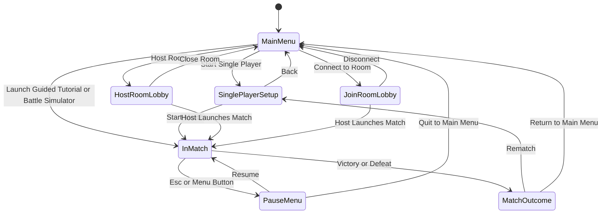

# HUD redesign and application state machine implementation plan

This document breaks the StarConquest UI overhaul into six small, verifiable phases. Each phase leaves the codebase building (`npm run build`) and passing unit tests (`npm test`) so work can pause and resume cleanly across sessions.

## Approved design decisions

1. **Perimeter Dock HUD with Contextual Bottom Inspector.** Replace the single `#hud-overlay` scroll column with four fixed screen regions: a slim top bar, a `228px` left outliner (`Standard Dock` only, no compact rail variant), a wide bottom-center contextual inspector (`min(800px, calc(100vw - 468px))`), and a bottom-right quick-action dock.
2. **Static Main Menu backdrop.** Render a lightweight dark CSS backdrop on the landing menu and pre-match lobby screens. Initialize and tick the Three.js WebGL renderer and simulation only after a match starts.
3. **Top-level application state machine.** Separate front-end navigation (`MainMenu`, `SinglePlayerSetup`, `HostRoomLobby`, `JoinRoomLobby`, `BattleSimulator`) from active match play (`InMatch`, `PauseMenu`, `MatchOutcome`). Remove lobby configuration drawers from the in-game HUD.
4. **Non-overlapping bottom inspector cards.** Size the bottom contextual panel with sufficient horizontal room and stack hull labels above `- / count / +` steppers with `min-w-0` so long names such as `Dreadnought` never clip or overlap buttons.

## Application state machine

## Target HUD layout

| Screen region | Contents | Behavior |
| :--- | :--- | :--- |
| **Top bar** | Ore, Crystal, Supply (`used / max`), Harvesters, active system name and yield, match clock, active contenders, KOTH banner (when active), speed (`1x`, `2x`, `4x`), music mute, `Menu (Esc)`. | Always visible during `InMatch`. Contains zero lobby or setup controls. |
| **Left edge outliner (`228px`)** | 5-node Galaxy switcher with reserves summary, current sector Planets and Wormholes, and Fleet list with `+ New` button. | Always visible during `InMatch`. Clicking an item jumps camera or selects it in the bottom inspector. |
| **Bottom-center contextual inspector** | Shows only the currently selected entity: Planet Orbital Ring and Build Cards, Fleet Composition Template and Stances, Harvester Telemetry, or Deep-Space Structure details. | Collapses to a single hint pill when nothing is selected. Max width `800px` (`calc(100vw - 468px)` cap) with stacked hull stepper cards to prevent text overlap. |
| **Bottom-right quick-action dock (`210px`)** | `+ Logistics Hub`, `+ PD Tower`, `+ Hull Breaker`, `Hub Mine` toggle, `Overview`. | Fixed position for predictable muscle memory. |
| **Top-right reserved slot** | Guided Tutorial Coach (when active) and transient toast notifications. | Fixed to `top` and `right` edges instead of `hudRoot.getBoundingClientRect().right`. |

## Implementation phases

Create one dedicated feature branch (`feature/hud-redesign-and-menu`) before starting Phase 1. Keep `main` untouched until all phases are verified and approved in a PR.

### Phase 1: App state machine and lazy match lifecycle

**Goal.** Introduce a typed finite state machine and decouple Three.js and simulation startup from page load.

**Files.**
- Create `src/client/app/appStateMachine.ts` defining `AppScreenState` (discriminated union) and pure transition reducers (`transitionAppState`).
- Create `src/client/app/__tests__/appStateMachine.test.ts` testing every valid and invalid state transition.
- Refactor `src/client/main.ts` so `bootstrapClient()` mounts the app shell in `MainMenu` without starting a `LocalSimAdapter` or WebGL render loop until entering `InMatch`. Add a clean `disposeMatchRuntime()` path when returning to `MainMenu`.

**Verification.**
- `npm run build` passes.
- `npm test` passes including `appStateMachine.test.ts`.

### Phase 2: Main Menu and pre-match setup screens

**Goal.** Move match preset selection, 4-slot Human/AI/Empty configuration, WebRTC Host/Join room flows, Guided Tutorial launch, and Battle Simulator entry into dedicated full-screen menu views.

**Files.**
- Create `src/client/ui/menuController.ts` rendering `MainMenu`, `SinglePlayerSetup`, `HostRoomLobby`, and `JoinRoomLobby` over a static dark CSS backdrop.
- Adapt `src/client/ui/lobbyController.ts` (or extract shared room/slot helpers) so P2P room creation, room code copy, manual SDP token exchange, and slot editing drive `HostRoomLobby` and `JoinRoomLobby` cleanly.
- Add Battle Simulator as its own `MainMenu` launch path that starts a sandbox match directly, removing the `battle_sim` section from normal matches.
- Update `src/client/ui/__tests__/lobbyController.test.ts` to cover the new setup flows.

**Verification.**
- `npm run build` passes.
- `npm test` passes.
- Loading the dev server displays `MainMenu` with zero active WebGL loop until a match starts.

### Phase 3: Split HUD shell, Top Bar, and Left Outliner

**Goal.** Replace the monolithic `#hud-overlay` column with perimeter layout regions and wire the Top Bar and Left Outliner.

**Files.**
- Update `index.html` CSS to define `#hud-root` (`pointer-events: none` full-viewport overlay) with dedicated anchored containers: `.hud-top-bar`, `.hud-left-outliner`, `.hud-bottom-inspector`, `.hud-quick-dock`, and `.hud-top-right-slot` (`pointer-events: auto` on each panel).
- Refactor `src/client/ui/systemHud.ts` (extracting `src/client/ui/topBarView.ts` and `src/client/ui/leftOutlinerView.ts` where helpful) to mount the slim Top Bar and `228px` Left Outliner.
- Remove `Match Lobby`, `Tutorial` quick-launch, and `Battle Simulator` buttons from the in-game Top Bar.
- Preserve existing `data-system-id`, `data-planet-id`, `data-speed`, and `data-select-fleet` attributes so tutorial highlighting and existing tests keep working.

**Verification.**
- `npm run build` passes.
- `npm test` passes.

**Phase 3 implementation notes.**
- `LobbyController` stays mounted inside `.hud-top-right-slot` for King of the Hill and match outcome banners until Phase 5 replaces it with the centered `MatchOutcome` overlay.
- `TutorialController` already anchors inside `.hud-top-right-slot` without `getBoundingClientRect()` positioning. Phase 5 keeps the remaining work (Pause Menu, MatchOutcome overlay, and dead `tutorialSteps.ts` branch cleanup).
- `Hub Mine` (`[data-action="toggle-hub-mining"]`) and `Overview` (`[data-action="overview"]`) already live in `.hud-quick-dock`. Phase 4 adds the deep-space placement buttons to the quick dock.

### Phase 4a: Move Deep-Space Installations to the Quick Action Dock

**Goal.** Remove the Deep-Space Installations section from the bottom-center display and place its build actions in the right-hand Quick Actions dock.

**Tasks.**
- Remove the `Deep-Space Installations` section from `.hud-bottom-inspector` (and remove `deep_space` from `HudSectionId`).
- Add `Place Logistics Hub`, `Place Point Defence` (PD Tower), and `Place Hull Breaker` buttons (preserving `data-place-deepspace` and `data-action="cancel-deepspace"`) into `.hud-quick-dock` alongside `Hub Mine` and `Overview`.
- Keep Logistics Hub radius gating (PD Tower and Hull Breaker disabled until a friendly Logistics Hub is complete in the active system).
- Update `src/client/ui/__tests__/systemHud.test.ts` to assert deep-space placement controls live in `.hud-quick-dock` and no longer appear in `.hud-bottom-inspector`.

**Verification.**
- `npm run build` passes.
- `npm test` passes.

### Phase 4b: Contextual Bottom Inspector (Fleet-Only When Fleet Selected)

**Goal.** Make `.hud-bottom-inspector` strictly contextual so selecting a Fleet shows only Fleet information (no Planet / Orbital Ring Builder and no Deep-Space Installations), and selecting a Planet, Harvester, or Deep-Space Structure shows only that entity.

**Files.**
- Extract or refactor the bottom panel renderer (for example `src/client/ui/contextualInspectorView.ts` and `src/client/ui/quickDockView.ts`) driven by a single typed `HudSelectionState` (`planet | fleet | harvester | deep_space | none`).
- When a Fleet is selected, render only the Fleet header, actions, stacked Fleet hull cards (hull name and supply on row 1, `- / count / +` stepper on row 2, `min-w-0` so `Dreadnought` and all other classes render with zero overlap), and Stance controls. Omit the Orbital Ring Builder while a Fleet is selected.
- Implement the wide bottom container (`width: min(800px, calc(100vw - 468px))`).
- Clicking empty space in the 3D viewport clears selection and collapses the bottom inspector to a subtle hint pill.
- Preserve `data-slot-index`, `data-build-struct`, `data-fleet-inc`, and `data-action` selectors used by `TutorialController`.
- Update `src/client/ui/__tests__/systemHud.test.ts` for contextual selection switching (including Fleet-only inspector output) and empty-selection collapse.

**Verification.**
- `npm run build` passes.
- `npm test` passes.

### Menu follow-up task 1: Main Menu layout and Feedback button

**Goal.** Reorder the Main Menu action cards into a 2-column grid matching the target layout and add a GitHub Issues Feedback button.

**Tasks.**
- Arrange the Main Menu cards in `src/client/ui/menuController.ts` (and CSS in `index.html`) into three explicit rows:
  1. Top row: `Guided Tutorial` (left) and `Start Single Player` (right, primary highlight).
  2. Second row: `Host Online Room` (left) and `Join Online Room` (right).
  3. Third row: `Battle Simulator` (left) and `Feedback` (right).
- Wire the `Feedback` button/link to open `https://github.com/Harkole/StarConquest/issues` in a new tab (`target="_blank" rel="noopener noreferrer"`).
- Update `src/client/ui/__tests__/lobbyController.test.ts` to verify card order and the `Feedback` link URL.

**Verification.**
- `npm run build` passes.
- `npm test` passes.

### Menu follow-up task 2: Single Player Skirmish exclusive Human slot swap

**Goal.** Enforce exactly one Human slot in Single Player Skirmish so selecting `Human` on another starter system swaps the player into that sector and converts the previous Human slot into an AI Bot.

**Tasks.**
- In Single Player Skirmish (`src/client/ui/menuController.ts` and `src/client/ui/lobbySetupHelpers.ts`), allow only one slot to be `Human`; all other slots may only be `AI Bot` or `Empty`.
- When the player clicks `Human` on a different sector slot, assign that slot to `Human` (updating `localPlayerId` to that slot) and automatically switch the previously Human slot to `AI Bot` (preserving all other slots' current `AI Bot` or `Empty` state).
- Never allow zero Human slots or multiple Human slots in Single Player Skirmish.
- Add unit tests in `src/client/ui/__tests__/lobbyController.test.ts` verifying Human-to-AI slot exchange and confirming untouched slots remain unchanged.

**Verification.**
- `npm run build` passes.
- `npm test` passes.

### Phase 5: Pause Menu, Match Outcome overlay, and Tutorial Coach anchoring

**Goal.** Complete the in-match lifecycle overlays and decouple Tutorial Coach positioning from the old left column.

**Files.**
- Add `PauseMenu` modal overlay triggered by `Menu (Esc)` button or `Escape` key (`Resume`, `Restart Match`, `Mute Music`, `Quit to Main Menu`). Pause local single-player simulation ticks while open; keep P2P multiplayer simulation running.
- Move Victory and Defeat banners (`MatchOutcome`) into a centered post-match overlay with `Rematch` and `Return to Main Menu`.
- Update `src/client/ui/tutorialController.ts` to anchor inside `.hud-top-right-slot` instead of calculating `hudRoot.getBoundingClientRect().right`, and remove any dependency on collapsed section toggles that no longer exist.
- Update `src/client/ui/__tests__/tutorialController.test.ts`.

**Verification.**
- `npm run build` passes.
- `npm test` passes.

### Phase 6: End-to-end verification, documentation sync, and release prep

**Goal.** Prove the redesigned UI in a live browser session and sync all source-of-truth docs.

**Tasks.**
- Run live browser verification following `.agents/skills/verify-starconquest/SKILL.md`: test `MainMenu` -> `SinglePlayerSetup` -> `InMatch`, click planets, orbital slots, fleets (checking `Dreadnought` card spacing), harvesters, deep-space placement, `Esc` pause menu, `Quit to Main Menu`, and `Guided Tutorial` step highlighting.
- Update `README.md` Section 7 and Section 8 and `.agents/skills/verify-starconquest/features/` docs to match the new menu flow and split HUD.
- Bump minor version in `package.json` once the user confirms the branch is complete.

## Progress tracker

- [x] Phase 1: App state machine and lazy match lifecycle
- [x] Phase 2: Main Menu and pre-match setup screens
- [x] Phase 3: Split HUD shell, Top Bar, and Left Outliner
- [x] Menu follow-up task 1: Main Menu layout and Feedback button
- [x] Menu follow-up task 2: Single Player Skirmish exclusive Human slot swap
- [x] Phase 4a: Move Deep-Space Installations to the Quick Action Dock
- [x] Phase 4b: Contextual Bottom Inspector (Fleet-only when Fleet selected)
- [ ] Phase 5: Pause Menu, Match Outcome overlay, and Tutorial Coach anchoring
- [ ] Phase 6: End-to-end verification, documentation sync, and release prep
